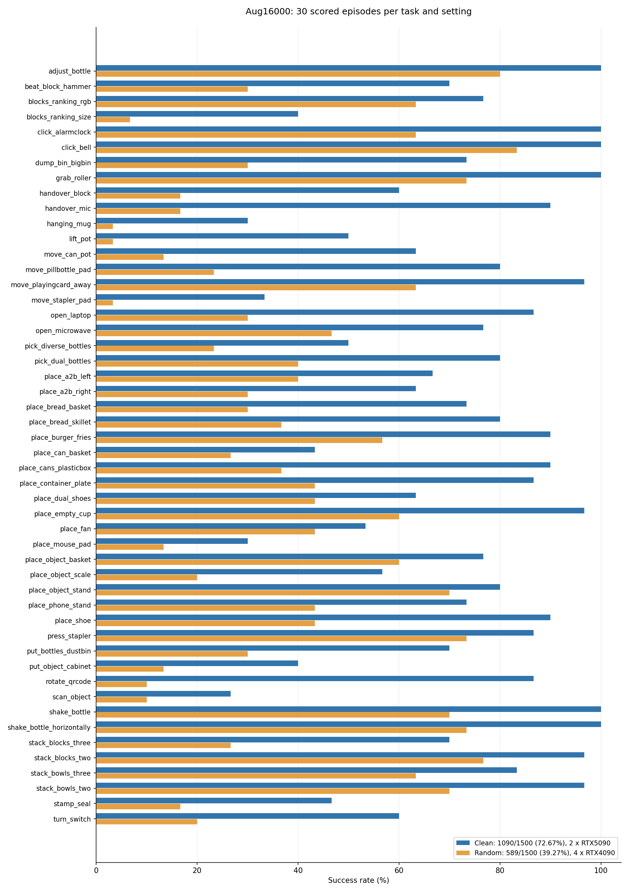

# HumaLog Aug16000：Clean／Random完整3000回合评测

结果日期：2026-10-25。模型为Lab20k-FullSFT-Aug16000，50个任务各Clean30与Random30，共3000计分回合；100组全部完成。

| 设置 | 成功／计分回合 | 成功率 | 硬件 |
|---|---:|---:|---|
| Clean | 1090/1500 | 72.67% | 两张RTX5090 |
| Random | 589/1500 | 39.27% | 四张48GB RTX4090 |
| 合计／两设置均值 | 1679/3000 | 55.97% | 同一模型 |

本轮使用同一FP32学生与own相对臂／绝对夹爪统计，256图像、10flow、H50预测／前25执行后重观测。官方seed参数0对应真实环境候选100000—100299递增，每任务／setting取得30个计分回合。模型进程启动seed42，各执行段内连续RNG；恢复产生新执行段，不逐回合重置。

本轮为无专家筛选的开发评测，录像关闭。Clean与Random使用不同硬件及环境／RNG，结果描述两种setting的实测表现，不作为增强或硬件的单因素因果证据，也不替代赛方复测。

## 完整性与输入

六个完成回执和本地读回SHA全部通过；3000个唯一任务／setting／seed计分键，100组各30，没有缺组或重复计分。0个策略超时。432次原生策略前初始化错误另列，并顺延候选种子；另保留2次策略进入前工程错误，按原键合法接续，不增加分母、不重复已计分回合。原错误原文与完成审计一起保存。

六卡实际验收均核对1672参数tensor和36持久buffer的FP32原值、实际CUDA／渲染设备、三路uint8 RGB、own norm、H50有限动作与前25执行。相同正式冻结输入在两类运行环境的11项预处理tensor SHA一致，动作归一化往返容差1e-6通过。完成审计记录47104块有限50×14预测及18000张初始／终帧RGB PNG元数据；本次发布只复核既有本地小回执和CSV，没有重读远端模型、图像或录像。

## 文件

- [官方计数JSON](aug16000-clean-random-3000-20261025/results.json)
- [50任务成绩CSV](aug16000-clean-random-3000-20261025/by-task.csv)
- [3000回合CSV](aug16000-clean-random-3000-20261025/outcomes.csv)
- [本地结果核对](aug16000-clean-random-3000-20261025/local-result-verification.json)
- [原始六分片回执](aug16000-clean-random-3000-20261025/shards/)
- [图像预处理一致性回执](aug16000-clean-random-3000-20261025/preprocessing/)

## 逐任务计数

| 任务 | Clean成功／次数 | Clean成功率 | Random成功／次数 | Random成功率 |
|---|---:|---:|---:|---:|
| adjust_bottle | 30/30 | 100.00% | 24/30 | 80.00% |
| beat_block_hammer | 21/30 | 70.00% | 9/30 | 30.00% |
| blocks_ranking_rgb | 23/30 | 76.67% | 19/30 | 63.33% |
| blocks_ranking_size | 12/30 | 40.00% | 2/30 | 6.67% |
| click_alarmclock | 30/30 | 100.00% | 19/30 | 63.33% |
| click_bell | 30/30 | 100.00% | 25/30 | 83.33% |
| dump_bin_bigbin | 22/30 | 73.33% | 9/30 | 30.00% |
| grab_roller | 30/30 | 100.00% | 22/30 | 73.33% |
| handover_block | 18/30 | 60.00% | 5/30 | 16.67% |
| handover_mic | 27/30 | 90.00% | 5/30 | 16.67% |
| hanging_mug | 9/30 | 30.00% | 1/30 | 3.33% |
| lift_pot | 15/30 | 50.00% | 1/30 | 3.33% |
| move_can_pot | 19/30 | 63.33% | 4/30 | 13.33% |
| move_pillbottle_pad | 24/30 | 80.00% | 7/30 | 23.33% |
| move_playingcard_away | 29/30 | 96.67% | 19/30 | 63.33% |
| move_stapler_pad | 10/30 | 33.33% | 1/30 | 3.33% |
| open_laptop | 26/30 | 86.67% | 9/30 | 30.00% |
| open_microwave | 23/30 | 76.67% | 14/30 | 46.67% |
| pick_diverse_bottles | 15/30 | 50.00% | 7/30 | 23.33% |
| pick_dual_bottles | 24/30 | 80.00% | 12/30 | 40.00% |
| place_a2b_left | 20/30 | 66.67% | 12/30 | 40.00% |
| place_a2b_right | 19/30 | 63.33% | 9/30 | 30.00% |
| place_bread_basket | 22/30 | 73.33% | 9/30 | 30.00% |
| place_bread_skillet | 24/30 | 80.00% | 11/30 | 36.67% |
| place_burger_fries | 27/30 | 90.00% | 17/30 | 56.67% |
| place_can_basket | 13/30 | 43.33% | 8/30 | 26.67% |
| place_cans_plasticbox | 27/30 | 90.00% | 11/30 | 36.67% |
| place_container_plate | 26/30 | 86.67% | 13/30 | 43.33% |
| place_dual_shoes | 19/30 | 63.33% | 13/30 | 43.33% |
| place_empty_cup | 29/30 | 96.67% | 18/30 | 60.00% |
| place_fan | 16/30 | 53.33% | 13/30 | 43.33% |
| place_mouse_pad | 9/30 | 30.00% | 4/30 | 13.33% |
| place_object_basket | 23/30 | 76.67% | 18/30 | 60.00% |
| place_object_scale | 17/30 | 56.67% | 6/30 | 20.00% |
| place_object_stand | 24/30 | 80.00% | 21/30 | 70.00% |
| place_phone_stand | 22/30 | 73.33% | 13/30 | 43.33% |
| place_shoe | 27/30 | 90.00% | 13/30 | 43.33% |
| press_stapler | 26/30 | 86.67% | 22/30 | 73.33% |
| put_bottles_dustbin | 21/30 | 70.00% | 9/30 | 30.00% |
| put_object_cabinet | 12/30 | 40.00% | 4/30 | 13.33% |
| rotate_qrcode | 26/30 | 86.67% | 3/30 | 10.00% |
| scan_object | 8/30 | 26.67% | 3/30 | 10.00% |
| shake_bottle | 30/30 | 100.00% | 21/30 | 70.00% |
| shake_bottle_horizontally | 30/30 | 100.00% | 22/30 | 73.33% |
| stack_blocks_three | 21/30 | 70.00% | 8/30 | 26.67% |
| stack_blocks_two | 29/30 | 96.67% | 23/30 | 76.67% |
| stack_bowls_three | 25/30 | 83.33% | 19/30 | 63.33% |
| stack_bowls_two | 29/30 | 96.67% | 21/30 | 70.00% |
| stamp_seal | 14/30 | 46.67% | 5/30 | 16.67% |
| turn_switch | 18/30 | 60.00% | 6/30 | 20.00% |
