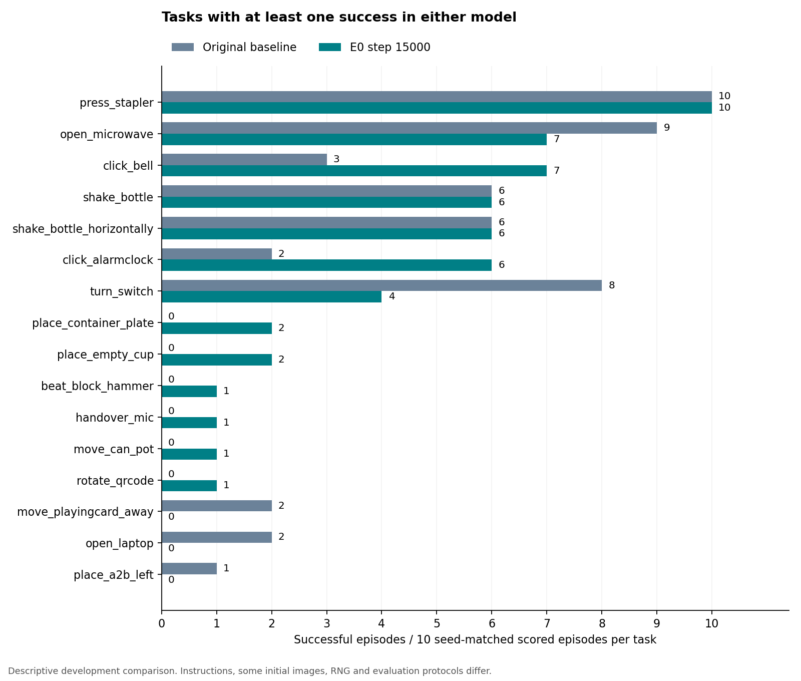

# 原始基座与E0 15000步：同seed开发对照

**最终报告。** 数据快照时间：北京时间2026-10-10 18:06:27。

500个相同 `task/setting/seed` 键已全部配对，每个任务在Clean和Randomized下各5个。基座采用旧结果复用412个、补测88个的用户选择；多余旧88个只从新比较视图排除，原始文件和任务均保留。

在当前500个配对计分键中，基座成功49次，E0成功54次，净差+5次。这是同seed开发对照；指令、部分初始画面、归一化、模型进程RNG、权重精度及专家筛选协议并不完全相同，不能把差值直接解释为E0微调的因果收益。

## 总体和环境分组

|范围|配对计分键|基座成功|E0成功|E0减基座|基座完整执行|基座超时0分|
|---|---:|---:|---:|---:|---:|---:|
|合计|500|49/500（9.8%）|54/500（10.8%）|+1.0个百分点|496|4|
|clean|250|26/250（10.4%）|33/250（13.2%）|+2.8个百分点|247|3|
|randomized|250|23/250（9.2%）|21/250（8.4%）|-0.8个百分点|249|1|

补测计分88/88，完整执行84，900秒超时4，成功1；复用412个历史回合成功48。完整策略失败与超时0分都进入计分分母，但两者分别报告。E0此前500个完整有效回合54成功，原报告未改。

原基座旧500回合中有52次成功；本次排除的88个非目标键包含4次成功，再加入补测的1次成功，得到52−4+1=49。这是对齐集合变化，不是更改旧结果。新88中的唯一基座成功为 `turn_switch/demo_randomized/100016`。在同一批补测键上，E0为2/88；在复用的412键上，基座48/412、E052/412。

评测端的判断：两个部署版本的整体任务完成率都较低；E0在本集合上的总体成功数略高，但Clean增加、Randomized减少，尚不支持“全面提升”或“泛化增强”的结论。检查文档提出的数值链路验收仍有未覆盖项，既不能把全部失败直接归因于模型能力，也不能用尚未测定的精度/后端影响来解释掉低分。

## 成功集中在哪些任务

基座在10/50个任务中出现过成功，E0在13/50个任务中出现过成功。按每任务Clean与Randomized合计10次，E0有8个任务成功数增加、5个减少、37个持平；E0有37个任务本次0/10，基座有40个。小样本0/10不表示任务永远不可完成。

下表列出至少一侧成功过的全部任务。括号内为该任务10个计分键的成功率；持平仅指总数，不保证成功seed集合相同。

|任务|原始基座|E0|E0成功数差|
|---|---:|---:|---:|
|press_stapler|10/10（100.0%）|10/10（100.0%）|+0|
|open_microwave|9/10（90.0%）|7/10（70.0%）|-2|
|click_bell|3/10（30.0%）|7/10（70.0%）|+4|
|shake_bottle|6/10（60.0%）|6/10（60.0%）|+0|
|shake_bottle_horizontally|6/10（60.0%）|6/10（60.0%）|+0|
|click_alarmclock|2/10（20.0%）|6/10（60.0%）|+4|
|turn_switch|8/10（80.0%）|4/10（40.0%）|-4|
|place_container_plate|0/10（0.0%）|2/10（20.0%）|+2|
|place_empty_cup|0/10（0.0%）|2/10（20.0%）|+2|
|beat_block_hammer|0/10（0.0%）|1/10（10.0%）|+1|
|handover_mic|0/10（0.0%）|1/10（10.0%）|+1|
|move_can_pot|0/10（0.0%）|1/10（10.0%）|+1|
|rotate_qrcode|0/10（0.0%）|1/10（10.0%）|+1|
|move_playingcard_away|2/10（20.0%）|0/10（0.0%）|-2|
|open_laptop|2/10（20.0%）|0/10（0.0%）|-2|
|place_a2b_left|1/10（10.0%）|0/10（0.0%）|-1|

较明显的计数变化是：click_alarmclock与click_bell各增加4次，turn_switch减少4次；open_microwave从9/10到7/10，press_stapler两侧均10/10。E0独有成功任务包括beat_block_hammer、handover_mic、move_can_pot、place_container_plate、place_empty_cup和rotate_qrcode；基座独有成功任务为move_playingcard_away、open_laptop和place_a2b_left。它们描述本次样本中的变化，不是对任务难度或原因的单独鉴定。

## 逐键改善与退化

- 双方成功：28。
- E0成功、基座失败：26。
- 基座成功、E0失败：21。
- 双方失败：425。

这些是按官方成功标记统计的逐键差异，不是对失败原因的自动判断。每个任务/环境仅5个目标键，0/5不能解释为模型在该任务上永远无法成功。

## 逐任务成绩

下表“基座/E0成功”中的 `a/b` 表示两侧各自的成功次数，不是成功率分数。Clean、Randomized每格的共同分母均为5，合计共同分母为10。例如闹钟Clean的 `1/5` 表示基座1/5成功、E0 5/5成功。

|任务|已配对/目标|Clean 基座/E0成功|Randomized 基座/E0成功|合计 基座/E0成功|E0净增|基座超时|
|---|---:|---:|---:|---:|---:|---:|
|adjust_bottle|10/10|0/0|0/0|0/0|+0|0|
|beat_block_hammer|10/10|0/1|0/0|0/1|+1|0|
|blocks_ranking_rgb|10/10|0/0|0/0|0/0|+0|0|
|blocks_ranking_size|10/10|0/0|0/0|0/0|+0|0|
|click_alarmclock|10/10|1/5|1/1|2/6|+4|0|
|click_bell|10/10|1/5|2/2|3/7|+4|0|
|dump_bin_bigbin|10/10|0/0|0/0|0/0|+0|0|
|grab_roller|10/10|0/0|0/0|0/0|+0|0|
|handover_block|10/10|0/0|0/0|0/0|+0|0|
|handover_mic|10/10|0/1|0/0|0/1|+1|0|
|hanging_mug|10/10|0/0|0/0|0/0|+0|0|
|lift_pot|10/10|0/0|0/0|0/0|+0|0|
|move_can_pot|10/10|0/0|0/1|0/1|+1|0|
|move_pillbottle_pad|10/10|0/0|0/0|0/0|+0|0|
|move_playingcard_away|10/10|1/0|1/0|2/0|-2|0|
|move_stapler_pad|10/10|0/0|0/0|0/0|+0|0|
|open_laptop|10/10|1/0|1/0|2/0|-2|0|
|open_microwave|10/10|5/3|4/4|9/7|-2|0|
|pick_diverse_bottles|10/10|0/0|0/0|0/0|+0|0|
|pick_dual_bottles|10/10|0/0|0/0|0/0|+0|0|
|place_a2b_left|10/10|1/0|0/0|1/0|-1|0|
|place_a2b_right|10/10|0/0|0/0|0/0|+0|0|
|place_bread_basket|10/10|0/0|0/0|0/0|+0|0|
|place_bread_skillet|10/10|0/0|0/0|0/0|+0|0|
|place_burger_fries|10/10|0/0|0/0|0/0|+0|0|
|place_can_basket|10/10|0/0|0/0|0/0|+0|0|
|place_cans_plasticbox|10/10|0/0|0/0|0/0|+0|0|
|place_container_plate|10/10|0/2|0/0|0/2|+2|0|
|place_dual_shoes|10/10|0/0|0/0|0/0|+0|0|
|place_empty_cup|10/10|0/1|0/1|0/2|+2|0|
|place_fan|10/10|0/0|0/0|0/0|+0|0|
|place_mouse_pad|10/10|0/0|0/0|0/0|+0|0|
|place_object_basket|10/10|0/0|0/0|0/0|+0|0|
|place_object_scale|10/10|0/0|0/0|0/0|+0|0|
|place_object_stand|10/10|0/0|0/0|0/0|+0|0|
|place_phone_stand|10/10|0/0|0/0|0/0|+0|0|
|place_shoe|10/10|0/0|0/0|0/0|+0|0|
|press_stapler|10/10|5/5|5/5|10/10|+0|0|
|put_bottles_dustbin|10/10|0/0|0/0|0/0|+0|4|
|put_object_cabinet|10/10|0/0|0/0|0/0|+0|0|
|rotate_qrcode|10/10|0/0|0/1|0/1|+1|0|
|scan_object|10/10|0/0|0/0|0/0|+0|0|
|shake_bottle|10/10|4/4|2/2|6/6|+0|0|
|shake_bottle_horizontally|10/10|3/3|3/3|6/6|+0|0|
|stack_blocks_three|10/10|0/0|0/0|0/0|+0|0|
|stack_blocks_two|10/10|0/0|0/0|0/0|+0|0|
|stack_bowls_three|10/10|0/0|0/0|0/0|+0|0|
|stack_bowls_two|10/10|0/0|0/0|0/0|+0|0|
|stamp_seal|10/10|0/0|0/0|0/0|+0|0|
|turn_switch|10/10|4/3|4/1|8/4|-4|0|

## 场景和输入是否相同

当前500个配对键中，三路初始RGB像素一致490个，初始关节一致500个，精确指令一致50个；三者同时一致50个。这里只核对保存的初始策略输入，不证明整回合观测、模型噪声流或全部评分内部状态相同。

复用的412个旧基座键中，405个初始三相机一致、412个初始关节一致、43个精确指令一致。旧基座每seed生成1条模板，E0专家路径生成5条再抽取，因此同seed并不保证相同文字。7个原有图像差异均为randomized：dump_bin_bigbin的100010/100013/100016/100019，put_bottles_dustbin的100010/100015/100017。部分物体/杂物初始位姿也不同，根因未定位。补测输入的逐键比较同样保存在comparisons.json，不将旧412的比例误用于全部500。

本次补测已发现的初始RGB差异键：dump_bin_bigbin/demo_randomized/100020；place_fan/demo_randomized/100019；put_bottles_dustbin/demo_randomized/100021。这里只确认保存的像素不同，没有把差异直接归因于任何单一原因。

## 900秒超时的计分

用户明确要求继续，并接受已说明的900秒超时记0、不重跑、继续下一固定seed的口径。原put_bottles_dustbin/clean/100015在900秒时仍在推进；原始部分轨迹和录像保留。没有采用1500秒延长方案。后续具备合法策略证据的同类总时限超时记policy_timeout，success=false、policy_completed=false、video_complete=false。240秒无进展、程序崩溃或证据异常仍停机诊断。

|任务|环境|seed|完整动作前缀|预测块|计分|
|---|---|---:|---:|---:|---:|
|put_bottles_dustbin|demo_clean|100015|1400|29|0|
|put_bottles_dustbin|demo_clean|100016|1300|27|0|
|put_bottles_dustbin|demo_clean|100017|1400|29|0|
|put_bottles_dustbin|demo_randomized|100021|1300|27|0|

超时动作数量仅是已完整记录的前缀，末个观察到的动作可能未完成；部分录像不作完整终帧承诺。超时零分让固定键计分完整，但不能把这些回合称为完整有效策略回合。原一次超时与一次候选间联动停止，共2次历史队列中断仍披露；原超时已经进入候选记录，不重复加到actual_attempts。恢复后被正常结算的超时不自动等于队列再次停机。

## 对照“评测前做的检查”文档的验收状态

参考用户提供的《E0/F1评测前模型数值链路验收说明》。其中“F1正式训练已完成”的状态已被用户纠正为尚未训练完成；本报告仅涉及基座与E0。文件提出的检查要求作为验收范围，不作为已经通过的事实。

|文档检查项|已有证据|仍需保留的边界|
|---|---|---|
|checkpoint与norm绑定|E0实际training.pt与norm的SHA匹配训练交接；基座使用自己的上游norm，模型来源已冻结。|E0实际导出与正式FP32原值导出存在59张量差异，不能称为同一数值版本。基座与E0各自绑定norm，并非误把同一份norm强塞给两者。|
|实际有效配置|既有运行协议保存FP32/high、FA2/MoE/compile、图像256、chunk/execute50、10步flow及进程seed。训练交接记录内部动作55、L1_fm及bounds_99_woclip。|训练YAML不等于运行时证明；本次汇总没有新做文档列出的全部robot config解析值和缓存来源专项审计。|
|50×55到50×14动作反算|E0全部500回合5728预测块形状50×14且有限，预测与轨迹对应；补测84完整回合按同一动作/录像验收，超时只核前缀。|形状与有限值不能代替完整反算等价证明；全体关节合理范围、相邻步变化、持续饱和/不动尚未形成系统分类统计。|
|导出前后及新进程重载一致|训练者有固定输入/噪声、FP32+SDPA/reference MoE/compile关闭的动作审计，容差atol=rtol=1e-6。|实际E0权重曾BF16舍入，生产后端FA2/fused MoE/compile不同；未证明部署链路在相同条件下满足完整动作1e-6一致性，不能标成全项通过。|

没有证据表明norm误配；也没有证据证明大量失败都来自无动作、震荡或关节异常。既有5个失败案例的观察只能作为现象例子，不用于估计全体失败频率。后续优先补固定观测、指令、噪声、dtype和后端的数值链路对照；本报告未启动额外模型/仿真/训练，未用诊断重跑替换计分结果。

## 模型、协议与解释边界

- 基座为robbyant/lingbot-vla-v2-6b，revision 11c703bf6a5c1f45b3b69168482da11fdbba53d7，原六分片及上游norm；补测模型7fc2558f926d，无专家筛选、模板1、固定88场景不替换seed。
- E0为15000步部分动作专家微调，非LoRA。59个可训练FP32张量导出时舍入BF16，再以FP32执行；不是训练者保留FP32原值的正式导出。最大参数差0.006281852722167969，尚未测定对动作/成绩的影响。E0使用训练配套的clean绝对动作norm，与原基座norm不同。
- E0旧385回合与后115回合的专家预算/异常处理规则不同；旧36条拒绝可能受错误包装影响，其中2条证实误拒绝、34条未逐一复核。不能把本次差值当作统一赛事成绩或纯微调效果。
- 推理配置均为官方be969b8f、FP32/high、FA2、official fused MoE、CUDA、compile、256图像、chunk/execute50、10步flow及原生噪声。FA2视觉QKV转BF16，不能称全部算子严格FP32。训练者SDPA/reference MoE/compile关的参考审计未证明与生产后端完整动作一致。
- 进程从seed42开始，回合不重置模型RNG。E0有10个执行段，本次基座补测有2个；恢复未保存原RNG，不宣称同seed对应同噪声。
- 新完整补测回合保存头部及observer双视角，10fps、仿真1倍速、共享采样时钟；observer不入策略。旧412回合按原录制版本保留，超时录像按部分证据保存。
- 基座配对集合的实际录像：头部139份、全局88份；历史回合中361个原记录明确video_requested=false，保留关键帧和轨迹入口，不补造录像或重跑。

E0的阶段明细为：旧筛选阶段46/385，按每个待补回合五次专家预算的第一阶段0/11，采用官方外层专家异常计数后的阶段8/104，合计54/500。每个待补回合五次是用户批准的本地协议解释，不声称主办方已明确确认该映射。共815条候选记录，其中107次初始化失败、202次正常专家拒绝、6次专家异常；计入未重复记账的历史中断后实际828次尝试。16次历史中断、其中6次运行报错完整保留；既有报告已逐项说明。基座本次88次补测没有专家调用、初始化失败或未处置程序错误，4次超时另列。

## 验收、耗时与证据

补测任务5e6bb9b40356创建时间：北京时间2026-10-10 02:19:22；快照中任务状态completed，最后更新时间2026-10-10 18:02:04。中间包含超时停机、用户选择等待及重新编译，墙钟差不能解释为纯推理耗时。每回合记录耗时见comparisons.json。

只读验收确认：固定目标500键/100组各5，复用412与补测88不交叉；当前补测88个计分结果按固定顺序出现，全部旧前缀、恢复清单及21份历史episodes文件SHA不变；500个E0冻结episode和412个复用基座episode文件哈希未变。84个新增完整回合复用逐回合动作/录像/末帧验收，4个超时的部分证据SHA核对通过。当前快照未执行新模型、仿真或专家调用。

- [汇总](baseline-e0-same-seed-20261010/summary.json)、[逐任务](baseline-e0-same-seed-20261010/by-task.json)、[500键与输入/录像入口](baseline-e0-same-seed-20261010/comparisons.json)。
- [逐键成绩和视频入口](baseline-e0-same-seed-20261010/paired-outcomes.md)、[超时部分证据](baseline-e0-same-seed-20261010/timeouts.json)、[排除的旧88键](baseline-e0-same-seed-20261010/excluded-old-88.json)。
- [成功回合索引](baseline-e0-same-seed-20261010/successful-episodes.md)、[用户提供的检查文档原文](baseline-e0-same-seed-20261010/reference-pre-eval-checks.md)。
- [验收及收据索引](baseline-e0-same-seed-20261010/verification.json)、[完整回合验收内容](baseline-e0-same-seed-20261010/acceptance-checks.json)、[补测原结果行](baseline-e0-same-seed-20261010/new-candidate-records.json)。
- [最终运行验收](baseline-e0-same-seed-20261010/final-heartbeat.json)、[超时继续计分授权](baseline-e0-same-seed-20261010/timeout-user-authorization.json)、[交付核验](baseline-e0-same-seed-20261010/delivery-verification.json)。
- [E0最终报告](e0-15000-final.md)、[E0失败案例](e0-15000-final/error-analysis/index.html)、[E0交接审计](e0-15000-handoff-audit.md)。

视频、远端关键帧与轨迹链接通过本机18788隧道访问，需隧道在线；报告、成绩、图表和验收JSON保存在仓库，可离线阅读。现有5个失败案例与1个成功参照已做双视角全量CPU解码和时序图查看，复用原证据，不重新诊断、不声称人工逐帧观看全部视频。所有官方成功标记保留，包括hammer只检查XY距离与接触、没有冲击阈值的评分规则。F1尚未训练完成，本报告没有F1结果，也未启动F1评测。
