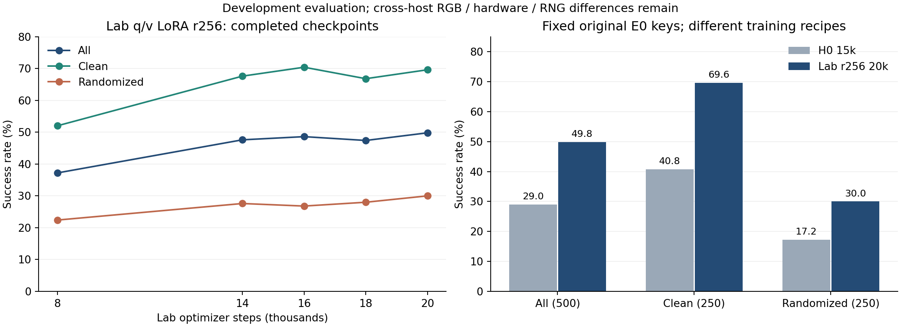

# Lab q/v-LoRA r256 与 H0：训练及固定500回合评测报告

整理日期：2026-10-16。完成成绩来自已归档、已通过CPU全量审计的回执；本次只在本地复核原字节SHA和CSV，不重新查询已结束任务，也不读取大权重或录像。

**当前结果：Lab r256 20k为249/500（49.8%），H0 15k为145/500（29.0%），相差104个成功回合、20.8个百分点。** 两者覆盖相同的原E0固定500个键，但训练数据划分、可训练模块、动作/norm、loss、优化器、训练预算以及评测硬件/RNG均有差别。这是两套实际配方的开发结果，不能把全部收益归因于LoRA，也不能据此判断LoRA优于语言主干全量微调。



## 1. 已完成成绩

Clean与Randomized各250回合；“完整执行”包含策略成功和普通失败。超时零分单列，不等于普通失败；本表各轮都没有正式超时。

| 模型 / checkpoint | 完整执行 | 超时零分 | 总成功 / 500 | Clean / 250 | Randomized / 250 |
| --- | ---: | ---: | ---: | ---: | ---: |
| Lab r256 8k | 500 | 0 | 186（37.2%） | 130（52.0%） | 56（22.4%） |
| Lab r256 14k | 500 | 0 | 238（47.6%） | 169（67.6%） | 69（27.6%） |
| Lab r256 16k | 500 | 0 | 243（48.6%） | 176（70.4%） | 67（26.8%） |
| Lab r256 18k | 500 | 0 | 237（47.4%） | 167（66.8%） | 70（28.0%） |
| **Lab r256 20k** | **500** | **0** | **249（49.8%）** | **174（69.6%）** | **75（30.0%）** |
| H0-A 15k | 500 | 0 | 145（29.0%） | 102（40.8%） | 43（17.2%） |

20k是本轮已完成Lab检查点中总成功数最高的一份；16k的Clean成功数略高。14k之后总成功率在47.4%–49.8%之间波动，不能仅凭单次固定500回合中的小差距证明继续加训必然改善或发生过拟合。8k还包含一次已记录的跨主机迁移，其172+328分段与后续完整soarm运行的区别见第5节。

逐任务结果见[50任务CSV](lab-qv256-h0-20261016/by-task.csv)，汇总见[summary.csv](lab-qv256-h0-20261016/summary.csv)与[summary.json](lab-qv256-h0-20261016/summary.json)。全部六轮共3000个已结算策略回合；各轮的门检均不进入500分母。

## 2. 相同键上的20k与H0对照

这里的键是`(task, setting, seed)`。本次实际将两个CSV都与原E0 paired-reference逐键核对：500唯一键、50任务×2设置×5、100组各5，无重复或缺失。

| 范围 | 两者都成功 | 只有Lab20k成功 | 只有H0成功 | 两者都失败 | Lab净增加成功 |
| --- | ---: | ---: | ---: | ---: | ---: |
| 全部500 | 118 | 131 | 27 | 224 | +104（+20.8个百分点） |
| Clean 250 | 93 | 81 | 9 | 67 | +72（+28.8个百分点） |
| Randomized 250 | 25 | 50 | 18 | 157 | +32（+12.8个百分点） |

按每任务10回合汇总，Lab20k在40个任务上成功数更高，5个持平，5个低于H0。改进并非覆盖所有任务。完整配对表见[paired-lab20k-h0.csv](lab-qv256-h0-20261016/paired-lab20k-h0.csv)。

这些是已观察到的配对计数。相同seed不保证实际RGB、进程内随机流及硬件执行完全相同；本报告不将131对27解释为严格控制其余变量后的LoRA因果效果。

## 3. 两套训练配方

| 项目 | Lab q/v-r256 | H0-A / G2 |
| --- | --- | --- |
| 模型来源 | 固定LingBot-VLA-v2-6b官方基座重新训练 | 同系列6B基座；HF preflight记录6分片基座identity |
| 官方源码 | `be969b8fd117fb70550c5d4bf4bc328211b5b1b6` | 相同vendor revision |
| 数据输入 | 原始HDF5、按真实帧索引 | LeRobot v3.0转换数据 |
| clean示范 | 50任务×50=2500条全部用于训练 | 每任务0–44训练、45–49验证：2250训练、250验证 |
| 验证口径 | 没有45/5独立示范验证划分 | 每250步验证8 batches；15k窗口未达到续训阈值 |
| 机械臂动作 | 12关节相对`q[t+h]-q[t]` | 绝对关节目标 |
| 归一化 | arm逐horizon MeanStd；gripper绝对MinMax | absolute `bounds_99_woclip` |
| 语言主干 | 冻结原参数；36层q/v共72个LoRA模块，r256、alpha512、dropout0 | 冻结，不加LoRA |
| 视觉编码器 | 全量训练 | 冻结 |
| Action Expert | 全部36层，包括MoE/router/shared expert | 全部36层及相应state/action/time projections |
| loss | L2 flow matching `fm` + 深度/视频对齐 + MoE auxiliary | L1 flow matching `L1_fm`；无在线深度/视频教师loss |
| 在线教师 | 冻结MoGe2+MoRGBD、DINO-video；`no_grad`生成目标 | 不执行教师目标生成 |
| 图像增强 | 官方配对颜色增强，已修复raw255边界 | 关闭 |
| 优化器 | 官方Muon + AdamW fallback | AdamW |
| LR | cosine `1e-4 → 5e-5`，无warmup | cosine `5e-5 → 5e-6`，warmup50 |
| weight decay / clip | 0 / 1.0 | 0.01 / 1.0 |
| 训练硬件 | 4×RTX4090 48GB，FSDP2 full shard | 2×A800 80GB，upstream FSDP2 |
| 单卡batch / 累积 / global | 32 / 1 / 128 | 32 / 1 / 64 |
| optimizer steps / processed samples | 20,000 / 2,560,000 | 15,000 / 960,000 |
| checkpoint | 每2000步，最终20k已完整归档 | 每500步，保留5k/10k/15k；本次闭环只测15k |
| seed | Python/NumPy/Torch为42；采样与worker细节见下文 | 配置seed42；不能据此宣称与Lab样本/RNG流相同 |

Lab总可训练参数为2,447,810,103，其中LoRA只有94,371,840；它不是“只训练LoRA”。语言原参数4,022,468,096冻结，视觉、Action Expert与对齐/动作投影同时更新。完整模型合并LoRA后为6,375,906,359参数，1672个参数tensor，另计36个持久buffer。

H0的发布CLI中仍包含上游alignment默认字段，但`train_expert_only=true`且`use_future_image=false`。实际训练入口不生成深度/视频教师目标，不能把CLI里存在的默认loss权重当作已执行监督。

Lab训练损失最终为total `0.013946533203125`、flow L2 `0.0092315673828125`；H0训练交接记录train loss `0.0442564269`、validation BC `0.0309427495`。loss定义、norm与数据划分不同，这些数值不作跨模型排名，也不代替闭环成功率。

完整训练资料：[Lab正式训练交接](../../训练端_Lab_QV256正式训练交接.md)、[Lab实际runtime配置](../../train/evidence/lab_qv256_20261012/training_runtime_config.json)、[H0正式训练交接](../../训练端_H0正式训练交接.md)、[H0配置](../../train/h0/configs/train_h0_full_expert_2gpu.yaml)。

### 3.1 Norm、数据与seed身份

| 身份 | Lab r256 | H0 |
| --- | --- | --- |
| norm SHA256 | `b24e6a7ccf44fa3ecc9dbbe060cf9b0937cf3307bc2a68232bc98c4578c22f6d` | `0b8b5ee5b2a1e9f8a658a5a84ade1dce58ba80cb92eaee122bee264ab99906c3` |
| robot config SHA256 | `1ef96ff0d213561174813345f8674fc693f4831cde144e00e5b9781d7147876b` | `2c2a26509fc9662a8ada64adaa7fa959627dd6dadc6b48b680c4285da2d8ffd8` |
| 训练manifest SHA256 | `911e7ea61baecd505368fe6d5eb70052827b989ba91f93b6d6d13d331df28e78` | `a4a4c28978d3a70ec0b46fb4cbafa8a3d47a721d0d151a4a5e6796c8ad3e383d` |
| 基座身份口径 | HF revision `11c703bf6a5c1f45b3b69168482da11fdbba53d7` | preflight base identity SHA `2e727a4c9be84d1a9fe8952544fed421df65fd32b8e543f0bc468f6aeb508a81` |

Lab用官方`StatefulDistributedSampler(shuffle=True, seed=42)`，有确定的真实帧索引；保留分片尾部补齐与`drop_last=True`，不宣称每epoch恰好无重复覆盖。DataLoader generator为`42+rank`，样本指令/增强seed为`42 + epoch×549787 + sampler_index`；每rank实际2个spawn worker。

Lab arm统计shape为`[50,12]`。反归一化的每个horizon都加同一次当前`q[t]`，不能沿时间累加；夹爪保持绝对值、不加state，保存统计shape为`[50,2]`，各horizon min/max相同。H0走自己的绝对动作/norm链路。两份norm和robot config不能互换。

Lab三路RGB均为256×256；brightness0.7–1.3、contrast0.6–1.4、saturation0.5–1.5，当前/未来及三路共用同组颜色参数。HDF5 float RGB `[0,255]`在增强前转`[0,1]`、增强后还原；processor和教师各按入口约定只缩放一次。

### 3.2 数值与导出

Lab保留原FP32基座及可训练master，训练使用官方模块混合精度：Action blocks FP32，vision/language/root BF16 compute，梯度reduction FP32；不能简写成“全程FP32计算”。H0训练路径保留冻结BF16主干、FP32可训练master和FSDP2 BF16前向。两者完整推理归档均为FP32存储，本次正式闭环也都实际检查为FP32。

Lab20k四份最终result均passed、final_step20000，complete为world4，4模型+4data共8份readback_equal全true。72层merge的物理动作max abs差`2.4383886154666357e-7`，独立reload为`1.1561431190187932e-7`、canonical差0，在共同参考后端下通过`1e-6`容差。

H0发布的[原action audit](lab-qv256-h0-20261016/evidence/h0-original-action-audit.json)是FP32存储、BF16重载/执行，normalized/physical差均0。它没有证明当前官方FP32闭环后端与训练输出逐位等价。Lab的参考审计也没有作这种承诺。

## 4. 本次闭环协议与执行

- 每轮严格沿用原E0的50×2×5：原instruction、parameters、policy_episode_index、seed与实际14维初始关节不改；100组各5。输入参考SHA为`ec14ae2092bca38a689feca77b98dc89317bf9add20b820dd67e2d4bd503dd20`，scene-replay SHA为`e7d34a4f042d81bee8c0bf5183f982032f6fe7c0ee9c68f43e8d294526612397`。
- 仿真专家/规划筛选关闭，正式500专家尝试为0。模型内部MoE正常启用，两者不是一回事；策略失败继续原下一键。
- FP32、FA2 vision、official MoE、compile开启、matmul high、图像256、50预测/执行50、10 flow steps、原生模型噪声、cache=false；head与observer双路10fps录像。
- 模型观察为head/左右wrist三路RGB与当前关节；observer仅用于监控录像，不作为第四路模型输入。
- 900秒墙钟或240秒无完整动作块的真实策略超时计0并继续，不重跑正式超时；真实输入、基础设施、GPU或保存错误不能伪造成策略0分。
- 每个模型先完成原4项不计分门检，完整执行、有限50×14、原输入/实际RGB、参数/norm及双路录像验收通过后提交正式500；本表没有把门检加入分母。

Lab14k/16k/18k/20k各自在soarm单物理5090上一个模型/worker覆盖完整500。H0在4张物理4090上各放一份完整模型和独立仿真，四分片各125键/25完整组，总共500，不是每卡500，也不是DDP。H0分组为`balanced_serpentine_groups_v1`，各卡Clean/Randomized为65/60、60/65、65/60、60/65。

实际运行均检查完整6,375,906,359参数FP32，1672份保存参数精确值与36个持久buffer、各自norm和真实GPU对应关系。H0[正式启动核验](lab-qv256-h0-20261016/evidence/h0-startup-verification.json)记录四份实际副本与原500分配。

## 5. 完成证据和比较边界

| 轮次 | 有限50×14动作块 | 实际三路初始RGB PNG | 终帧PNG | 非空双路视频元数据 |
| --- | ---: | ---: | ---: | ---: |
| Lab8k | 4795 | 1500 | 1000 | 1000 |
| Lab14k | 4401 | 1500 | 1000 | 1000 |
| Lab16k | 4378 | 1500 | 1000 | 1000 |
| Lab18k | 4339 | 1500 | 1000 | 1000 |
| Lab20k | 4333 | 1500 | 1000 | 1000 |
| H0-15k | 5139 | 1500 | 1000 | 1000 |

原远端CPU完成审计核验了原输入、实际PNG/RGB、所有有限动作块与终帧/非空视频元数据；本次报告只核对其已完成小回执和CSV，不重新跑一遍图像/录像审计。视频元数据通过不等于本次逐帧人工复核整段视频。

需要保留的比较边界：

1. **训练因素同时变化。** Lab训练用了更多示范、2.67倍processed samples、视觉训练、LoRA、相对MeanStd、L2、在线教师和不同优化器；H0只是Action Expert全量训练，语言/视觉冻结。这里没有语言主干全量微调对照，也没有独立通用VLM能力评测。
2. **实际图像不完全相同。** Lab14k–20k三路各500张初始RGB均与E0不同；Lab8k租用段172回合相同、迁移后328回合不同。H0记录实际RGB/PNG，但不宣称E0像素等同。跨主机差异已按各任务授权留证，原输入键一致不消除渲染差异。
3. **执行硬件和RNG不同。** Lab20k为soarm单5090；H0为四4090、四进程各seed42。没有恢复旧单进程的连续RNG流。历史E0为BF16，而本表正式闭环为FP32；参考动作审计、训练混合精度与正式后端也不逐位等价。
4. **这是固定开发500。** 多检查点/多系数在同一500上比较属于开发集选参，没有独立保留测试集或多训练seed重复；不报告为赛事官方成绩，不据此声称通用VLM能力已恢复或受损。
5. **H0训练源码身份有两份历史记录。** 旧训练交接写源码`e2e0ca1d72a588882e09c7049da2b89471ffb0d1`、配置SHA `90923edddef34af3fbead82fd508e8a219d185c37a167649fe3bad6fceb0dc32`；HF随包[原preflight](lab-qv256-h0-20261016/evidence/h0-original-preflight.json)写源码`fe10d77962d53a0e5e16c26eaca4d4f323550d8f`、配置SHA `264e1af83aaa04293e399b79976d17c05fd001e92e2a2409bdc36cb940ea89d3`。norm、robot、manifest与基座identity一致；两套源码/config差异尚未逐项对齐，保留原字节，不把现有训练文档当作完整训练时字节复现证明。闭环结果则绑定下表固定HF revision与已校验参数，不依赖把两份训练源码记录冒称相同。

Lab8k迁移前172条结果及其分片前缀SHA完整保留，迁移后只执行余下328键；已结束的旧Xid109事件根因未被本次结果证明解决。旧Lab15000取消维护与本报告的Lab r256/H0均是独立任务。

## 6. 模型和回执索引

| 模型 | 固定HF来源 | 当前使用 |
| --- | --- | --- |
| Lab r256 20k | [HumaLog/Lab-QV256 @84afa4f2](https://huggingface.co/HumaLog/Lab-QV256/tree/84afa4f2fbef16ad6d41dbb1c3b27967f2d7a8e6/experiments/lab_qv256_20261012) | `checkpoints/global_step_20000/hf_ckpt_fp32`；14完整分片，已合并LoRA；按同包assets加载自己的相对norm |
| H0-A 15k | [HumaLog/H0 @2a6d763e](https://huggingface.co/HumaLog/H0/tree/2a6d763eb1662a723ec44a1f4323a85caa588b80) | 50完整分片；自己的absolute bounds norm |

两个HF仓库为私有，需要已有访问权限。Lab完整归档为84文件、45,161,047,200字节，包含训练恢复状态；只做推理不需要下载训练state。此报告不重新上传、重打包或更改任何checkpoint。

| 模型 | 正式job / model | verification SHA256前16位 |
| --- | --- | --- |
| Lab8k | `7cc771a96d5c` / `f8ba918c658a` | `d9530233eeec3038` |
| Lab14k | `4c46678e65fe` / `3ef5e65bd332` | `b4229877bf2c3034` |
| Lab16k | `b31757398e92` / `699af9858492` | `8f3a67af99f17711` |
| Lab18k | `6ee1e5d31f2b` / `63ec23691d27` | `538518564565461e` |
| Lab20k | `52f2fcba9037` / `b5b77a85461b` | `58ff04a1afd0203a` |
| H0-15k | `5dbebc941071` / `b69e723177f9` | `560a6bef0f7d5e71` |

完整SHA、原始verification、CSV、receipt-manifest及原E0 reference均在[离线证据包](lab-qv256-h0-20261016/)。Git不携带大权重、训练state、原始视频或账号凭据。

## 7. 进行中的RETAIN与后续判断

截至本报告冻结的小状态（2026-10-16 16:29北京时间），RETAIN语言合并的α=0.5/0.75/0.8/0.9四个正式500仍在运行，合计目标2000；**不将部分回合成功率放入上述最终表格，也不提前选优**。每个α独占一张4090、各自跑原完整500，与H0四卡总500的分配不同。

α表示20k语言参数占比：`theta_language = (1-alpha)*theta_base + alpha*theta_20k`；只在已合并语言权重上操作，视觉、action、projection和Lab相对norm保留20k。已完成的8k/14k/16k/18k/20k/H0不因此重评，原20k249/500回执作为α=1基线。唯一一次α0.8未完整冷启动门检补全及其旧partial结果另有回执；所有门检/补全均不进正式2000分母，正式超时不复用门检补全规则。

目前最明显的结果缺口是Randomized：Lab20k为30.0%，比其Clean低39.6个百分点；且双方在157/250个Randomized键上都失败。可先结合[逐任务表](lab-qv256-h0-20261016/by-task.csv)定位集中失败任务，再用已有证据分辨感知、语义和动作阶段问题。当前计数没有逐录像失败归因，不直接把它归结为语言遗忘。

RETAIN全部完成后先比较Clean/Randomized及配对输赢；若要研究重采样、增强强度或语言全量微调，需另立数据/预算/norm/seed/后端一致的受控实验。本文只是报告与建议，不启动新训练、不延长20k、不增加评测回合。

## 8. 离线复算

在仓库根目录执行，仅需Python标准库：

```bash
python eval/results/lab-qv256-h0-20261016/recompute.py --check
```

该命令验证29份冻结输入文件的SHA、各轮原manifest列出的所有小文件、原500键/100组/250+250分母、状态/成功计数与receipt一致性，然后比对已提交汇总、逐任务及配对CSV。它不会启动模型、访问服务器或重新审计视频。

重新生成表格用同一脚本不带`--check`；重画图增加`--plot`（需matplotlib）。原始证据按`-text`属性保存，避免Windows换行转换破坏SHA。数据与本次交接索引的区别见[证据说明](lab-qv256-h0-20261016/README.md)。
