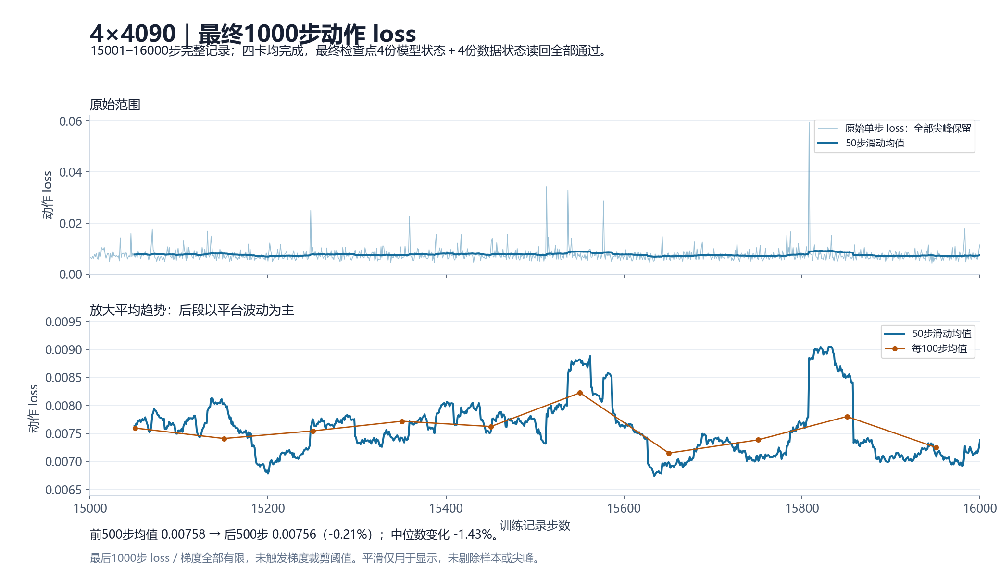

# HumaLog：LingBot-VLA 2.0复现与调优说明

编写日期：2026-10-24；更新日期：2026-10-25。本文说明HumaLog提交模型的训练流程、数据处理、增强策略、推理配置及复现方法。闭环评测次数与成功次数在本候选评测完成后填写。

## 1. 基础信息

| 字段 | 内容 |
|---|---|
| 团队名称 | HumaLog |
| 天池team_id | 1380507 |
| 指定起点 | [LingBot-VLA 2.0官方6B预训练模型](https://huggingface.co/robbyant/lingbot-vla-v2-6b) |
| 代码来源 | [LingBot-VLA 2.0官方仓库](https://github.com/Robbyant/lingbot-vla-v2)及本方案适配代码 |
| 本次候选 | Lab20k-FullSFT-Aug16000，dense FP32学生模型 |
| 模型归档 | [HumaLog 16000步模型](https://huggingface.co/Humalog2/Lab20k-FullSFT-Aug16000) |
| 代码与模型版本 | 见[附录：版本与文件校验索引](evidence/version-index.md) |
| 规模 | 6,375,906,359参数，1672个参数tensor，36个持久buffer |
| 真机创新任务 | 本次暂不提交 |

模型名称中的16000指Lab20k之后的续训累计步数，沿本训练流程共完成36000次正式optimizer更新。

## 2. 训练复现

### 2.1 数据与训练谱系

仅使用官方RoboTwin 2.0 Aloha-AgileX的50任务、每任务50条Clean示范，共2500条。数据来源为[官方RoboTwin 2.0数据集](https://huggingface.co/datasets/TianxingChen/RoboTwin2.0)。没有加入Randomized示范、额外仿真rollout或外部动作数据。

| 阶段 | 训练内容 | 硬件与batch | 优化器与衔接 |
|---|---|---|---|
| 官方基座→原Lab20k | 视觉、Action Expert、投影全量训练；语言36层q/v使用72个LoRA模块，r256、alpha512、dropout0 | 4×48GB4090；micro32×累积1＝global128；20000更新 | 官方Muon及AdamW fallback；语言LoRA完成后合并为dense模型 |
| 原Lab20k→续训8000 | 学生全部参数开放、教师冻结；原有效帧比例采样 | AMD八卡；micro16×累积2＝global256；新增8000更新 | 以Lab20k稠密权重初始化，新建AdamW |
| 续训8000→10000 | 迁移到CUDA，继承完整Adam、图像规范和已核验的数据过滤 | 4×48GB4090；micro16×累积4＝global256；新增2000更新 | FSDP分片迁移后验收，继承Adam一阶／二阶矩及学习率进度 |
| 续训10000→16000 | 原比例采样，增强课程，全参数SFT | 4×48GB4090；micro16×累积3＝global192；新增6000更新 | 继承Adam，300步重新升温、5700步余弦衰减 |

后续8000＋2000＋6000步均为全参数SFT，全部学生参数参与更新，教师保持冻结；沿用原有效帧比例采样，EMA关闭。

最终11000切换后使用的23个核心源码文件位于代码材料src/final_runtime。分阶段实现、安装与入口见代码材料README.md、INSTALL.md及TRAINING.md；跨阶段身份迁移和独立GPU复现按实际验收状态记录。

### 2.2 原始帧索引与数据清理

原始有效起始帧549787，过滤后549737。窗口起点步幅为1，预测未来50步；不是每隔50帧才取一个窗口。

实际过滤排除`place_shoe/episode45`起始帧95—144，共50个跨越异常关节突跳的窗口，保留该轨迹其它有效窗口；另排除原指令池中已核实与场景冲突的指令候选。使用的指令均来自对应示范的原始指令池，并保留文本与索引。

具体筛选项见[数据过滤配置](../02_代码材料/configs/data-filter-plan.json)。

增强段使用实际官方StatefulDistributedSampler包装器，按有效帧原比例shuffle，继承epoch和已提交游标；没有按任务难度或关键窗口加权。分片补齐和drop_last仍存在，不能声称每个epoch绝对无重复、无遗漏。6000×192＝1152000个窗口曝光，约2.10个有效帧集合的量级，不等于所有样本严格出现两次。

### 2.3 归一化与动作定义

训练与推理使用同一套归一化统计及机器人字段映射，随模型提供norm_stats.json与robotwin_relative.yaml。发布包将资产位置改为相对路径，保留相同的状态和动作定义。

- 输入状态为14维真实绝对关节位置；左右臂各6维，夹爪位于索引6、13。
- 12维臂动作目标为`future_target[h] - q_now`，按每个horizon的MeanStd归一化，统计形状为50×12。
- 每个horizon反归一化后都加同一次q_now，不能沿预测时间递推累加。
- 两夹爪为绝对动作，沿用MinMax，动作统计形状50×2；不转换成臂相对量。
- 官方FeatureTransform映射到55维规范表示，padding和未使用维由mask排除。

RGB来自主视角、左腕、右腕。训练reader显式执行raw255→unit增强→raw255，Qwen processor按自身约定缩放一次。图像单位由输入接口明确规定，包括暗图在内均按同一约定处理。归一化及图像验收依据见完成回执和核心实现。

### 2.4 全量SFT与学习率

8000步以前的新AdamW：betas(0.9,0.95)、eps1e-8、weight decay0、全局梯度norm裁剪1；语言峰值1e-5、视觉5e-6、Action Expert与投影2e-5，500步warmup，原10000更新余弦至20%的调度在8000停止并于迁移后延续至10000。AMD段和迁移段global均为256。

增强6000步继承Adam矩和step，未新建优化器；foreach=false、fused=false，不对MoE专家叠加额外LR倍率。每3个microbatch完成一次全局裁剪及optimizer.step，不能把microbatch当正式更新计数。

| 参数组 | 增强段初值 | 第300步峰值 | 第6000步末值 |
|---|---:|---:|---:|
| Language | 2e-6 | 1e-5 | 3e-6 |
| Vision | 1e-6 | 1e-5 | 3e-6 |
| Action Expert | 4e-6 | 2e-5 | 6e-6 |
| Projection／alignment | 4e-6 | 2e-5 | 6e-6 |

令s为本增强段成功optimizer更新序号1—6000：

```text
s <= 300: lr(s) = initial + (peak-initial)*(s-1)/299
s > 300:  lr(s) = peak*(0.3 + 0.35*(1+cos(pi*(s-300)/5700)))
```

FP32主参数、Adam矩及保存参数与模块混合精度计算分开记录。学生所有类别有梯度和更新，教师无梯度。训练外层compile=false；训练attention配置与推理Flash Attention配置分别披露，不把二者混写。

### 2.5 增强课程与前景保护

前300步渐进过渡；稳态分支总概率为原图10%、普通增强33%、保护背景擦除50%、主视角整幅mask7%。50%是申请分支预算；安全背景不足、前景资产缺失或有效监督不足时回退普通增强，不保证所有申请都真实擦除。

| 方法 | 实际强度与使用范围 |
|---|---|
| 配对颜色 | brightness0.7—1.3、contrast0.6—1.4、稳态saturation0.7—1.3；当前／未来和多相机共享参数 |
| Gamma／弱噪声 | 非原图分支稳态选color50%、color+gamma25%、color+noise25%；gamma0.8—1.2，noise sigma0.003—0.01；像素噪声仅主视角学生 |
| 主视角几何 | 在11000完整点后启用全局45%申请概率，scale0.9—1.1、每轴平移严格小于6%、黑边填充；不旋转、不剪切、不翻转 |
| JPEG／模糊 | 仅可见增强分支主视角学生，条件分布none60%、JPEG25%、Gaussian10%、motion5%；JPEG55—95，高斯核3/5且sigma0.1—1，运动模糊核3 |
| 保护背景擦除 | 主视角矩形候选裁入安全背景，实际擦除面积需为全图5%—20%，保护前景膨胀7px并保护边缘12px，最多10次候选；无安全候选则回退 |
| 主视角整幅mask | 全局7%稳态分支，学生主视角填raw255中值127.5；腕相机保留；禁用对应无效辅助监督 |
| 腕相机 | 保留视觉信息，不做空间几何、背景擦除、整幅mask；允许共享配对颜色变换 |

前景来自冻结的公开GroundingDINO Tiny离线检测框，不是像素级分割真值。检测目标包括机器人／夹爪、交互对象、放置目标等；以框外扩和当前／未来保护并集限制擦除。实际擦除像素与保护区交集必须为0；矩形候选与前景相交时，只擦除其中安全背景部分。保护不等于证明没有漏检。

检测器采用[GroundingDINO Tiny](https://huggingface.co/IDEA-Research/grounding-dino-tiny)，实现来源为[GroundingDINO官方仓库](https://github.com/IDEA-Research/GroundingDINO)。仅对原Clean RGB冻结推理，不引入额外训练图片或动作标签；推理评测不加载检测器。press_stapler关闭背景矩形擦除，走普通增强回退，未更换该任务的模型或动作头。

10001—11000使用第一阶段几何配置；11000完整状态后切换至全局45%主视角几何配置，参数／buffer／Adam及实际输入、RNG、LR恢复验收通过。最终曲线采用切换后的11001—16000连续记录；回退重算部分的早期记录保留在归档中。

### 2.6 教师监督一致性

保留冻结的MoGe2／MoRGBD深度与DINO-video监督，原当前／未来深度及视频系数保持；原Lab配方depth、future_depth、video各0.004。教师不进入optimizer，推理包不包含教师大权重。

学生使用强增强，教师使用对应的弱增强RGB；两者及当前／未来帧共享同一空间几何参数。黑边、擦除、整幅主视角mask等使辅助目标失效的位置由有效性mask排除；整幅mask时不让主视角对应辅助损失迫使学生拟合不可见内容。腕相机保留，动作标签不随图像像素变换改写。

前景缓存与原始RGB及检测器版本绑定；原图不匹配或缓存损坏时报错，检测资格不足时回退增强并保留原数据索引。公开模块来源、版本和使用方式随代码材料披露。

## 3. 评测复现

### 3.1 本候选评测协议

本候选按下表中的冻结协议评测，逐任务实际次数和成功次数汇总至01_评测结果/results.json。当前评测计数待填写。

| 项目 | 本轮固定值 |
|---|---|
| 每组目标 | 50任务×Clean30＋Random30＝3000计分策略回合 |
| 硬件 | 四4090测Random，两5090测Clean；按实际冻结分片任务分配，最终记录各主机环境 |
| 种子 | 官方seed参数0，对应真实环境种子100000起；候选100000—100299递增 |
| 指令 | Clean=seen，Random=unseen，保存实际文本 |
| 推理 | 同一FP32权重，256图像、H50预测、执行前25后重观测、10flow |
| 后端 | 两端记录实际Flash Attention 2、official MoE、compile与matmul high |
| 专家 | 关闭；这是一轮无专家开发评测，不能声称完整复制上游专家筛选协议 |
| 录像与增强 | MP4／observer关闭；无训练增强、无DINO、无教师 |
| 分母 | 普通失败、有据策略超时记入；只有原生策略前初始化错误另列并补下一seed；工程错误保留并诊断 |

模型进程从采样seed42启动，随后沿用原生连续RNG；场景种子与模型RNG分开。跨主机相同seed不等于图像或动作逐位相同；显式恢复形成新RNG段，不能声称连续恢复。

冻结分片为Random13／13／12／12任务，Clean按两主机预先测速分为30／20任务。全部分片使用同一份模型，各任务每setting目标30次。

### 3.2 推理模型加载

模型交付目录为03_模型权重/checkpoint，保留发布包内的相对目录结构、processor与norm，推理配置入口为inference-cli.yaml。14份FP32权重共25,503,888,740字节，逐文件身份见model_manifest.json。

模型入口与文件清单见03_模型权重/model_manifest.json。HF仓库作为模型来源归档，提交文件使用与其一致的完整checkpoint。

评测入口为代码材料eval.sh，显式指定checkpoint-root、setting、GPU、端口及新工作目录。Clean与Random的完整命令见代码材料README.md，安装、公开资产与真实渲染检查分别见INSTALL.md和ASSETS.md。实际16000评测源码、RoboTwin任务／配置快照与两个运行环境版本已一并归档。

### 3.3 结果与官方要求

官网建议尽量完成每任务、每setting100次；FAQ允许受时间／算力限制按实测提交，最终以官方复测为准，且测试覆盖充分者有优先考虑。本轮若各完成30，JSON就逐项写attempts=30及真实successes；不补成100、不用百分比替代计数。

results.json保持schema_version、team_id、results及clean／randomized下50任务的attempts／successes结构。普通策略失败进入分母，初始化与工程异常按冻结协议分别记录；成功率由实际计数计算。

## 4. 代码改动说明

| 位置／内容 | 修改范围 |
|---|---|
| src/final_runtime/train_full.py、checkpoint.py | 全量FSDP2、分组AdamW、实际保存与读回、输入及身份回执 |
| src/final_runtime/data.py、official_sampler.py、stage_sampler.py、filtering.py | 原Clean reader、过滤、官方游标包装、global192边界与预取恢复 |
| src/final_runtime/aug6000/* | 显式RGB单位、教师／学生增强、背景保护与辅助监督mask、45%几何申请 |
| src/final_runtime/teacher_targets.py及support.py | 原冻结教师目标与批处理对接；support的旧入口不是本轮实际训练入口 |
| src/eval_runtime及src/robotwin_overlay | 本次实际评测执行源码、145份RoboTwin源码／配置／指令；分片、预测50执行25、关闭录像、无专家、超时／错误与输入动作回执 |
| RoboTwin任务与判分 | 保留原任务动作控制、step_lim和内置成功判定；未根据测试结果改变任务难度 |

训练状态保存Adam、RNG、loader及各rank参数；推理所需文件为dense学生及配套处理配置。源码与资产的精确版本信息集中保存在附录中。

## 5. 调优说明

本方案针对Clean训练向Random泛化设计：保留全部任务原帧比例和腕相机信息，增加主视角外观退化、空间变换及安全背景擦除，并以较低的分组学习率继续全量更新。语言与视觉一起适应，不只更新动作头；通过完整Adam继承和短升温缓和阶段切换。

训练效果通过动作loss与闭环任务成功率分别观察。本方案组合了学习率、数据清理与视觉增强，下面给出实际训练收敛统计；闭环结果按本候选的实测记录填写。

最后5000步动作loss按1000步分段：

| 阶段区间 | 均值 | 中位数 |
|---|---:|---:|
| 11001—12000 | 0.00989873 | 0.00934474 |
| 12001—13000 | 0.00900610 | 0.00853856 |
| 13001—14000 | 0.00841562 | 0.00782776 |
| 14001—15000 | 0.00796129 | 0.00748189 |
| 15001—16000 | 0.00757099 | 0.00707308 |

最后1000均值比此前1000下降约4.90%；最后前后500变化约-0.21%，已趋平。最后1000没有触发norm1裁剪，loss与梯度有限。曲线保留全部尖峰，5000条CSV无缺口、无重复，不含已回退的旧11001—11061。




原始CSV及统计见evidence/loss-scalars-11001-16000.csv、loss-summary.json。四rank均passed/final_step16000；11000—16000六份状态各8份readback true，共48份，见completion-receipts.json。训练loss是拟合指标，不是成功率。

## 6. 来源与证据

- [赛事提交说明](https://tianchi.aliyun.com/competition/entrance/532514/information)，于2026-10-24核对。
- 训练完成记录、导出说明、逐步loss和曲线保存在evidence目录。
- 模型、代码、数据与公开模块的精确版本及文件校验信息见[版本与文件校验索引](evidence/version-index.md)。
