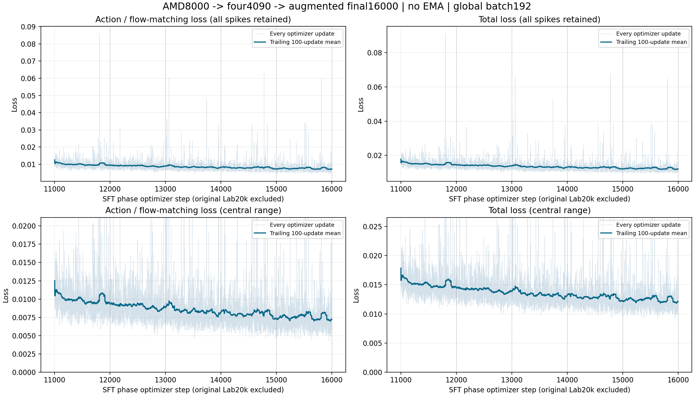

# AMD8000 → 四卡4090：增强续训至16000步完成记录

2026-10-24 19:43北京时间完成；四rank均`passed/final_step16000`。本阶段从10000新增6000次optimizer更新，六份11000至16000完整状态均保存并通过8份逐值读回，共48份。原始可恢复状态保留在四卡数据盘；本阶段按用户要求暂不备份到soarm101。

这条路线是**原始未RETAIN合并Lab20k → AMD八卡新增8000 → 四卡4090继续至阶段10000 → 四卡增强至阶段16000**。阶段16000不包含起点20k，沿本链累计36000次更新。它与旧的“四卡难任务重采样至12000”路线以及队友的R3/EMA草案分别记录；本模型没有EMA。

## 实际训练配方

| 项目 | 实际设置 |
| --- | --- |
| 学生 / 教师 | 6375906359学生参数全量更新；1672参数tensor、36持久buffer；深度/视频教师冻结 |
| 分布式 / batch | 四卡48GB4090，FSDP2 full shard；每卡16，累积3，global192 |
| 精度 / 优化器 | FP32主参数与Adam状态，原模块混合精度；完整继承AdamW矩，不重新建状态；betas(.9,.95)、eps1e-8、WD0，全局裁剪1 |
| 学习率 | 从阶段10000末值300步升温；语言/视觉峰值1e-5、动作/投影峰值2e-5；后5700步余弦至30%，最终3e-6/3e-6/6e-6/6e-6 |
| 采样 | 包装实际官方StatefulDistributedSampler，继承游标；按有效帧原比例shuffle；不加关键窗口或难任务重采样 |
| 数据 | 官方2500条Clean轨迹、549737个过滤后起始帧；只剔除place_shoe/episode45起始95..144的50个窗口，并排除已核实的冲突指令候选 |
| 动作 | 原相对关节MeanStd、绝对夹爪MinMax与掩码保持；norm SHA见下文 |
| 保存 | 每1000步完整保存；11000、12000、13000、14000、15000、16000共6份全部保留 |

新增6000步处理1152000个训练窗口，约为有效起始帧集合的2.10倍；具体覆盖由继承的官方游标、epoch shuffle及drop_last决定，不是关键帧抽样。

## 增强和教师监督

稳态分支：原图10%、普通视觉增强33%、前景保护背景矩形50%、主视角整幅mask7%。前300步渐进启用。保护来自冻结GroundingDINO离线框及保守外扩，只服务训练增强，不参与推理或动作标签。

按用户指定在11000完整状态后切换：主视角几何以**全局45%概率**申请0.9–1.1缩放及每轴小于6%平移，黑边填充，**不旋转**。几何变换不再被前景保护错误否决；保护框随几何变换，前景保护只限制背景擦除。腕相机保留，不做几何/擦除/整幅mask。原图与整幅mask分支的语义约束仍受保护。

颜色为brightness0.7–1.3、contrast0.6–1.4、saturation0.7–1.3；额外gamma0.8–1.2或轻噪声sigma0.003–0.01渐进引入。可见增强分支再选none60%/JPEG25%/Gaussian blur10%/motion blur5%，JPEG质量55–95。上述条件概率不能直接当作所有样本的全局发生率。

教师取对应的弱增强RGB，学生可有更强外观退化；当前/未来图像共享空间参数，学生/教师处于相同空间坐标，对遮挡/裁切失效的辅助监督位置做mask。raw255→unit→raw255显式一次；Qwen processor只缩放一次，不按图像最大值猜单位。推理禁用训练增强与检测器。

11000切换的参数/buffer/Adam逐值恢复、576个真实draw输入/RNG/LR和有限loss/梯度验收通过；旧方案11001–11061按用户要求重算，原证据保留，**不并入这份曲线或累计更新**。10001–11000仍是早期几何版本，不能把全部6000步写成45%几何。

## 最后5000步loss

下面逐步标量已在四rank间全局归约，每次optimizer更新只计一次；保留所有尖峰。4735条历史记录与最终1000条有735条完全相同交集，合并后11001–16000恰好5000条，无重复/缺口。

| 区间 | 动作loss均值 | 中位数 |
| --- | ---: | ---: |
| 11001–12000 | 0.00989873 | 0.00934474 |
| 12001–13000 | 0.00900610 | 0.00853856 |
| 13001–14000 | 0.00841562 | 0.00782776 |
| 14001–15000 | 0.00796129 | 0.00748189 |
| 15001–16000 | 0.00757099 | 0.00707308 |

最终1000均值较前1000下降4.90%，较切换后首1000下降23.52%。最后前/后500均值0.00757890→0.00756307，变化约-0.21%，末段已趋平；最终1000没有触发norm1裁剪，loss和梯度均有限。




[逐步CSV](completion-20261024/loss-scalars-11001-16000.csv)、[统计JSON](completion-20261024/loss-summary.json)、[六份保存/读回与四rank结果](completion-20261024/completion-receipts.json)。图的上排保留全部尖峰，下排仅放大中心范围；CSV未删尖峰。

## 16000推理模型交付

HF仓库：`Humalog2/Lab20k-FullSFT-Aug16000`（私有）。不可变目录：`experiments/amd8_to4090_aug6000_20261022/checkpoints/global_step_16000/`。已上传并按固定revision逐文件核验：[`2b1e8a52668d38dbc91a01bf0d83085ba7a8f8a1`](https://huggingface.co/Humalog2/Lab20k-FullSFT-Aug16000/tree/2b1e8a52668d38dbc91a01bf0d83085ba7a8f8a1/experiments/amd8_to4090_aug6000_20261022/checkpoints/global_step_16000)。14份权重的Hub LFS SHA256、所有小文件的固定revision下载SHA256与导出清单一致；仓库保持私有。

仅发布dense FP32学生权重、模型/推理配置、原norm与provenance、机器人字段映射及固定tokenizer/processor；不发布Adam、教师权重、RNG/loader状态或DINO缓存。完整文件通过SSH中转和官方HF SDK上传，不使用自定义16MiB文件片段。safetensors是常规模型分片，索引含全部1708个参数/buffer键。

原norm SHA256：`b24e6a7ccf44fa3ecc9dbbe060cf9b0937cf3307bc2a68232bc98c4578c22f6d`。源16000 complete SHA256：`59d62f44ff25e35818357145fdb741f9c037c3278e87c3d5f17325e72589012b`。上游LingBot-VLA-v2版本：`be969b8fd117fb70550c5d4bf4bc328211b5b1b6`。

推理使用原生LingbotVlaV2Policy加载dense权重；RGB为uint8 HWC0..255，三相机top/left-wrist/right-wrist，processor缩放一次；H50预测、10flow，动作每个horizon均相对同一q[t]恢复。执行25或50步属于另外的评测协议，不能混算。CPU导出和HF文件哈希核验不等同于新增GPU推理/闭环评测。

**本记录没有16000模型的新Clean/Randomized成绩。** 训练loss下降不能换算为成功率；也不与旧四卡、AMD8k或队友R3的不同协议成绩混排。

下载时保留共享推理资产，可只取本候选而不下载旧8000步权重：

```python
from huggingface_hub import snapshot_download
snapshot_download(
    repo_id="Humalog2/Lab20k-FullSFT-Aug16000",
    revision="2b1e8a52668d38dbc91a01bf0d83085ba7a8f8a1",
    allow_patterns=[
        "experiments/amd8_to4090_aug6000_20261022/checkpoints/global_step_16000/*",
        "assets/*",
        "processor/*",
        "README.md",
    ],
    local_dir="sft16000-inference",
)
```

先使用本机已有HF登录；推理工作目录切换到下载根目录，再解析该实验的`inference-cli.yaml`。完整可恢复训练状态仍留在原四卡数据盘，本次HF只承担推理模型交付。
