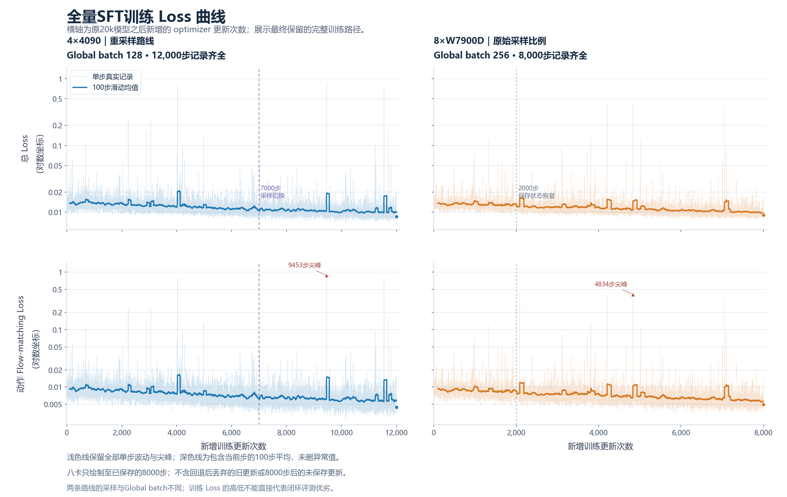
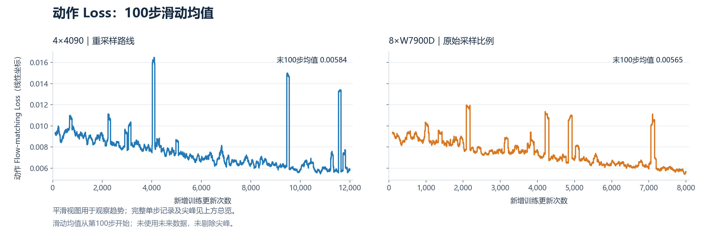

# LingBot VLA 训练策略与实验复盘

整理日期：2026年10月20日。范围：10月12日至20日的Lab20k训练、RETAIN权重插值、两条全量SFT路线、采样切换、数据诊断与八卡到四卡迁移。文中“+N步”均指从Lab20k之后新增的 **optimizer更新次数**，梯度累积中的microbatch和保存次数不算更新步数。

目前，4090重采样路线已完成+12000步；AMD八卡原比例路线在保住+8000完整状态后，按用户要求停止训练并完成500回合镜像开发评测。已有同协议2000回合对照支持4090的+5000全量SFT候选取得收益，但还不能把收益单独归因于重采样。新的AMD8000到四卡4090续训已获授权，截稿快照处于CPU重分片阶段，**尚未通过GPU恢复验收，也未正式开始后2000步**。

全文按模型来源区分三条记录：**4090重采样**、**AMD八卡原帧比例**、**AMD8000迁移到4090**。第三条继承AMD的模型与Adam状态；即便后续运行在4090上，也不并入第一条。下文两份loss文件只对应前两条最终保留的正式训练路径。

## 1 模型来源与实验时间线

```text
官方 LingBot VLA v2 6B 基座
  ├─ H0 Action Expert 路线 → 15000步停止，独立配方与norm
  └─ Lab QV256 → 原Lab20000步完整FP32模型
       ├─ RETAIN语言q/v插值 → 四个候选均完成固定500回合
       ├─ 4×4090全量SFT → 旧采样7000步 + 新采样5000步 = +12000
       └─ 8×W7900D全量SFT → 官方原帧比例，保存至+8000后停止
              └─ 迁移到4×4090 → 拟继承Adam续至+10000，验收中
```

| 时间 | 工作与实际结果 |
| --- | --- |
| 10月12日起 | 从官方基座训练Lab QV256；语言Q/V用r256 LoRA，视觉、Action Expert和投影直接训练；完成20000步 |
| 截至10月16日 | 原20k、H0与滚动检查点开发评测完成；RETAIN四个语言插值候选完成，总计2000个正式策略回合 |
| 10月17日起 | 4090从原20k开始全量SFT；图像、容量、完整保存和新进程恢复验收通过后正式运行 |
| 10月17日起 | AMD八卡从同一原20k独立全量SFT；采用官方原帧采样、global256与BF16计算路线 |
| 10月18至19日 | 4090原6000步采样交接失败，保留已完成更新；获授权改在7000步切换，再训练5000步 |
| 10月19日 | AMD在4000步保存保护处退出；修复保存资源逻辑后，获授权从完整2000状态恢复，重算后续更新 |
| 10月20日 | 4090完成+12000；12个千步检查点、共96份原读回回执通过。AMD保住+8000并停止训练，镜像500回合完成 |
| 10月20日新任务 | 以AMD+8000完整状态为父，做8→4重分片、过滤验收及恢复验收，再续至+10000；每1000步完整保存并异步备份 |

原始20k固定HF revision为 `84afa4f2fbef16ad6d41dbb1c3b27967f2d7a8e6`。两条全量SFT都从这份**未做RETAIN插值**的完整FP32模型开始，新阶段各自新建AdamW；新的8000→10000迁移则继承AMD已有Adam状态。后者不是再次新建空动量。

原Lab20k也不是“只有LoRA在训练”。它有约24.478亿可训练参数，其中语言Q/V LoRA约9437万，其余主要是视觉、动作专家与投影。合并LoRA后进行全量SFT，开放的是原先冻结的语言K/O、MLP、embedding等参数，以及已经训练过的学生模块；没有重新插入LoRA因子。

## 2 核心训练配置

| 项目 | 原Lab QV256 20k | 4090全量SFT | AMD八卡全量SFT | 新AMD8000到4090迁移 |
| --- | --- | --- | --- | --- |
| 起点 | 官方6B基座 | 原Lab20k稠密FP32 | 同一原Lab20k | AMD+8000完整状态 |
| 学生更新范围 | 语言Q/V LoRA，视觉、动作及投影直接训练 | 全部学生 | 全部学生 | 全部学生继续 |
| 学生参数 | 约24.478亿可训练 | 6,375,906,359个参数，1672个张量 | 同左 | 同左 |
| 硬件与并行 | 4×4090，FSDP2 | 4×4090，FSDP2 full shard | 8×W7900D，FSDP2 full shard | 4×4090，FSDP2 full shard |
| 每卡microbatch | 32 | 16 | 16 | 16，仍须容量验收 |
| 梯度累积 | 1 | 2 | 2 | 4 |
| Global batch | 128 | 128 | 256 | 256 |
| 优化器 | 官方Muon与AdamW fallback分组 | 新建AdamW | 新建AdamW | 继承AMD的AdamW矩、step与参数组 |
| 采样 | 官方逐帧shuffle | 任务加权、有放回；7000步后切换表 | 官方逐帧shuffle | 过滤后的官方逐帧shuffle |
| 训练进度 | 20000完成 | +12000完成 | 原计划+10000；保留+8000后用户停止 | +8000→+10000，验收中 |
| 完整保存 | 每2000步 | 每1000步，共12份保留 | 已归档2000、4000、6000、8000 | 要求9000、10000各一份，并异步备份 |

FSDP各rank共同训练一个学生模型，不是每卡独立训练一个候选。原Lab20k的语言LoRA配置是72个Q/V模块、`r=256, alpha=512, dropout=0`；原优化器基础学习率为`1e-4`，cosine至`5e-5`，无warmup，并保留约2.828倍的routed expert学习率倍率。全量SFT关闭了这个额外倍率，不能直接拿两条路线的标称LR比较实际更新幅度。

完整配方摘要见[recipes.json](training-review-20261020/recipes.json)。该文件是实验记录，不是可直接执行的启动配置。

## 3 共用数据与输入定义

### 数据范围和动作时间对齐

原训练输入为50任务、每任务50条官方Clean示范，共2500条、549787个有效起始帧。末帧没有下一动作，不作为起点。没有加入Randomized示范、外部训练数据、额外仿真rollout或重新渲染的观测。

训练窗口以当前观测和状态`t`为输入，第一个动作标签来自`t+1`，H50覆盖`t+1`至`t+50`，越界部分有padding mask。**起始帧不是每隔50帧取一次**；每个合法`t`都可以成为采样器索引，长度50指动作预测窗口。是否实际遍历每一帧，还取决于采样方法、drop_last和训练步数。

物理状态和动作有14维，进入模型时映射到55维canonical空间；未使用维度和无效尾部不计动作损失。

| 内容 | 保持的定义 |
| --- | --- |
| 12个机械臂关节 | 第h个目标为`q[t+h]-q[t]`，h=1…50；按每个horizon的MeanStd归一化 |
| 机械臂反归一化 | 每个horizon还原后都加同一个当前`q[t]`，不沿时间累加 |
| 两路夹爪 | 绝对位置，MinMax归一化；不加当前臂状态 |
| 当前图像 | 三路RGB，256×256 |
| 未来教师图像 | `min(t+49,last_frame)`，保留原实现的偏移 |
| 学生可见内容 | 当前图像、当前状态和指令；未来图像只用于教师目标 |

各阶段始终绑定Lab自身的相对arm与绝对gripper统计量。任务重采样、改变global batch或过滤窗口都没有重新估计norm，也没有进行临时batch标准化。不能换成H0或镜像另一模型的绝对动作统计量。

```text
norm SHA256     b24e6a7ccf44fa3ecc9dbbe060cf9b0937cf3307bc2a68232bc98c4578c22f6d
manifest SHA256 911e7ea61baecd505368fe6d5eb70052827b989ba91f93b6d6d13d331df28e78
```

### 图像归一化与增强

图像边界明确声明为浮点RGB `[0,255]`。增强内部显式除255，返回时显式乘255；学生processor与各教师分别做其需要的一次缩放。旧式“最大值小于1或2就当作unit图”的猜测会误判近黑raw图，因此只在新reader的局部子类中去掉该猜测，关闭内部第二次增强，没有修改共享旧入口。

| 位置 | 数值约定 |
| --- | --- |
| 解码、resize与增强返回 | float raw RGB `[0,255]` |
| 增强内部 | `[0,1]`，完成后还原raw255 |
| 学生Qwen processor | `do_rescale=true`、`rescale_factor=1/255`、mean/std均为`[0.5,0.5,0.5]` |
| 学生标准化表达式 | `(raw/255-0.5)/0.5` |
| 深度教师 | 对应增强RGB，经原helper转unit并执行教师自身处理 |
| 视频教师 | 对应增强RGB，经原helper转unit，再按其ImageNet mean/std处理 |

学生与教师共享的是同次增强后的对应RGB，不是共享已经标准化的张量。多相机、当前和未来帧共用色彩、gamma等变换参数；噪声实现有各视图和时刻自己的可复现随机流。

全量SFT稳态增强如下。前500次更新不加入额外gamma或噪声，随后200步渐进引入；4090延长至12000时，仍保留原增强日程，未把500步暗中改为600步。

| 分支 | 稳态概率 | 参数 |
| --- | ---: | --- |
| 原图 | 25% | 仅解码、resize及必要预处理 |
| 原色彩增强 | 50% | brightness 0.7–1.3，contrast 0.6–1.4，saturation 0.5–1.5 |
| 色彩加gamma | 12.5% | gamma 0.85–1.15 |
| 色彩加弱像素噪声 | 12.5% | unit空间高斯噪声sigma 0.003–0.01，随后clamp |

没有加入新裁剪、遮挡、几何变换、动作噪声或改变桌高后的渲染数据。实际验收覆盖0、0.5、2、127.5、255暗图到白图、真实HDF5、各增强分支、双spawn worker、教师RGB对应、动作往返和预取恢复；原动作往返容差为`atol=2e-5, rtol=1e-5`。

### 损失与冻结教师

沿用Lab的L2 flow matching，保留当前深度、未来深度和视频对齐。depth、future-depth和video配置系数均为0.004，内部MSE/cosine组合保持；MoE sequence-wise系数`1e-3`、router-z系数`1e-4`，额外手动bias更新关闭。

MoGe2、MoRGBD与视频教师保持eval、no_grad，不进入优化器。4090路线按单样本调用原目标函数控制显存；AMD八卡按整个micro16调用，新的AMD8000迁移保留这条教师执行方式。两种执行组织不能直接宣称算术逐位等价。

FSDP根输出可能把总损失与分项分别舍入为BF16，因此日志分项的重求和与总量允许相应dtype误差；反向仍使用模型返回的原总损失。

## 4 全量SFT的优化器与学习率

两条从20k开始的全量SFT阶段均使用新建AdamW：`betas=(0.9,0.95)`、`eps=1e-8`、`weight_decay=0`、`foreach=false`、`fused=false`。全部学生参数按身份去重，恰好进入一个参数组；全部microbatch反向完成后，全局梯度norm裁剪至1.0，再做一次optimizer更新。

| 参数组 | 峰值LR | 原10000步计划的终点LR |
| --- | ---: | ---: |
| Language，包括Q/K/V/O、MLP与embedding | 1e-5 | 2e-6 |
| Vision及merger | 5e-6 | 1e-6 |
| Action Expert | 2e-5 | 4e-6 |
| Projection及alignment | 2e-5 | 4e-6 |

选择AdamW是本轮实现和状态管理的取舍，没有完成AdamW与Muon的同条件训练对照。原20k使用的是Muon矩阵更新加AdamW fallback，不能把合并LoRA前的优化器直接当作全量稠密模型的恢复状态。Weight decay为0用于保持本轮变量范围，不代表0是最优值。

原总步数10000、warmup500，更新步u的LR倍率为：

```text
u ≤ 500：m(u) = u / 500
u > 500：m(u) = 0.2 + 0.4 × [1 + cos(π × (u-500)/9500)]
```

一次更新内每个microbatch的loss除以累积次数，LR只推进一次。AMD恢复2000与迁移8000都继续原进度，不重新warmup。4090从7000延长至12000时，前7000完全沿用原曲线，之后以`m(7000)=0.381220736751`为锚，平滑cosine至12000的0.2，没有重置Adam或抬高峰值。

| 阶段 | Language实际LR | Vision实际LR | Action与Projection实际LR |
| --- | ---: | ---: | ---: |
| 4090切换边界7000 | 3.8122e-6 | 1.9061e-6 | 7.6244e-6 |
| 4090延长曲线10000 | 2.6261e-6 | 1.3131e-6 | 5.2522e-6 |
| 4090终点12000 | 2e-6 | 1e-6 | 4e-6 |
| AMD原曲线8000 | 2.8434e-6 | 1.4217e-6 | 5.6869e-6 |
| AMD迁移后的原终点10000 | 2e-6 | 1e-6 | 4e-6 |

较小Language/Vision LR是控制已有表示漂移的设计，冻结深度与视频教师提供视觉相关约束。但没有独立通用VLM能力测试，不能据这些设置或任务成功率宣称通用视觉问答、语言理解能力已经得到保留。

## 5 4090的两阶段重采样

### 前7000步的18任务增曝光

基础任务概率为`p0(i)=该任务有效起始帧数/549787`，所以长任务原本就有更高曝光。最终采用的初始表给18个优先任务各自`1.4×p0(i)`，其余32个为`0.7826849013597422×p0(i)`；两组总概率分别约49.28%与50.72%。

这里“增加40%”是相对原概率增加，不是增加40个百分点，也不是预期成功率提高40%。直接把部分权重乘1.4、其它保持1再归一化，不会得到每个优先任务真正增加40%的结果。

| 初始类别 | 数量 | 任务 |
| --- | ---: | --- |
| Clean好而Random弱 | 11 | blocks_ranking_rgb、click_alarmclock、handover_mic、move_playingcard_away、pick_dual_bottles、place_bread_skillet、place_cans_plasticbox、place_object_stand、place_phone_stand、rotate_qrcode、turn_switch |
| 两种设置均弱 | 7 | blocks_ranking_size、hanging_mug、move_stapler_pad、place_a2b_right、place_fan、scan_object、stack_blocks_three |

先按任务目标概率选择任务，再按有效帧长度选择示范与起始帧；不能把任务内50条长短不同的示范改成等概率。抽样有放回，同一物理帧可以重复，global draw编号必须唯一。增强种子包含draw编号，因此重复帧可以得到不同但可重放的增强；没有再把task weight乘到loss上。

早期“先任务、再示范等概率”的方案会意外压低部分长任务曝光，已废弃；先前20%增幅也是设计历史，正式采用的是40%表。完整50任务见[初始采样CSV](training-review-20261020/sampling-initial.csv)。

### 7000步后的重新分组

新分组参考原20k更充分的开发结果，修正原名单遗漏，但没有根据训练期间每一轮loss动态调整概率。原6000边界交接失败后保留已完成更新，最终授权为7000步后再训练5000步。

| 新分组 | 任务数 | 后程相对原始帧比例 |
| --- | ---: | ---: |
| 双弱任务 | 13 | 1.4 |
| 中间弱任务 | 9 | 1.1 |
| Clean较好而Random弱 | 9 | 1.0 |
| 其余旧优先任务 | 5 | 1.0 |
| 其余覆盖任务 | 14 | 0.5658730206030121 |

13个双弱任务为beat_block_hammer、blocks_ranking_size、hanging_mug、lift_pot、move_stapler_pad、place_dual_shoes、place_fan、place_mouse_pad、put_bottles_dustbin、scan_object、stack_blocks_three、stamp_seal、turn_switch。此前未列入18任务的6个为beat_block_hammer、lift_pot、place_dual_shoes、place_mouse_pad、put_bottles_dustbin、stamp_seal；它们后程升至1.4倍。

7001至7200线性混合：`alpha=clip((u-7000)/200,0,1)`，`p(u)=(1-alpha)×p_old+alpha×p_new`；7201至12000使用新表。同一次optimizer更新内各rank、各microbatch共用该更新对应的alpha。

新表在整个12000步中的等效占比为40.8375%，所以不能把“后程1.4倍”写成“全阶段增加40%”。例如上述6个遗漏任务全阶段约为原分布的1.035倍，14个覆盖任务约为0.694倍。完整逐任务阶段与累计倍率见[切换后的采样CSV](training-review-20261020/sampling-after7000.csv)。这项预算取舍可能伤害覆盖任务，需要用全部任务的闭环结果判断。

### 切换时保留了哪些状态

从完整7000点恢复全部参数、36个持久buffer、Adam一二阶矩、step、参数组和主模型CPU/CUDA/Python/NumPy RNG。全局draw继续，下一段不从0重算。原预取状态保留为父证据，但不能把旧分布预取批次混入新协议；新loader自身必须能精确恢复。

工程参考与新进程恢复在同一新采样协议下比较全部参数、buffer、Adam、输入、RNG、LR及loss，最大差值均为0。通过后丢弃工程更新，重新从原7000启动正式5000步。10月20日已完成12000，并保留父1000至7000七份、子8000至12000五份完整状态。对应的初始4090恢复、7000切换和AMD真实2000恢复回执在本地分别归档。

## 6 AMD八卡的原始帧比例路线

AMD实际最终配置为`8×16×2=global256`，不是最初讨论的global128。采用安装环境中的`StatefulDistributedSampler(shuffle=true,seed=42)`，每个索引对应确定的有效起始帧，不做任务难度加权。

每rank读取32条，再分成两个micro16；sampler采用官方padding规则，DataLoader使用drop_last。每个epoch实际2147次更新、549632个不同原始帧，155个尾部帧未进入该轮更新；下一epoch重新shuffle。因此它保留原始帧比例，但不保证每epoch每帧都训练。

八卡+8000共约204.8万次抽样窗口；4090+12000为153.6万次。两条线同时改变了采样、global batch、算术后端、教师执行组织及动作模块计算精度，不能视作仅比较重采样的消融。

AMD原工程完整远端上传及新进程恢复门检曾由用户明确暂缓，不能写为已通过。后续真实2000恢复核对了八rank参数、buffer、Adam、连续LR、原RNG及官方下一批数据，并实际继续更新；这证明了该次恢复，不补写为最初暂缓的工程门检。

最后因实例剩余时间，用户选择保住8000后停止训练、改做评测。2000、4000、6000、8000均有完整归档；8000之后未保存的更新不算保留模型进度，也没有把原10000预算写成完成。

## 7 精度与注意力后端

| 层次 | 4090全量SFT | AMD八卡与新迁移 |
| --- | --- | --- |
| 学生主参数、Adam与完整保存 | FP32 | FP32 |
| Vision与Language模块计算 | BF16混合 | BF16混合 |
| Action blocks配置 | `action_fp32=true` | `action_fp32=false`，保留AMD路线 |
| 梯度归约 | FP32 | FP32 |
| 冻结教师计算 | BF16 autocast，单样本调用 | BF16 autocast，完整micro16调用 |
| 视觉注意力 | SDPA | SDPA |
| 联合语言与动作注意力 | flex_cached | flex_cached；日志明确为未融合实现 |
| 外层compile | 关闭 | 关闭 |

“FP32权重”与“每个算子都用FP32”是不同事实；同样，BF16模块配置不代表联合attention内部没有FP32转换。SDPA的开关也不足以证明实际选中的GPU内核就是FlashAttention。

用户授权AMD单独编译Flex的前向、反向一致性和完整更新测速。保持原Q/K/V、头数、mask与精度时，当前ROCm/Triton组合的反向编译在`TritonAMDGPUOptimizeDotOperands`失败，候选调整未通过门检。因此没有采用编译版，没有有效的完整更新提速结论，按授权回到原flex_cached。测试前未保存的87步退出后从原20k重启，不混入最终8000条保留路径。

4090完整更新容量实测如下，耗时包含教师、累积、反向、通信、裁剪和Adam，不是单次forward。

| 单卡microbatch与累积 | 后10次完整更新均值 | 峰值allocated | 结论 |
| --- | ---: | ---: | --- |
| 8与4 | 33.572秒 | 36.904GiB | 20步及保存通过，容量对照 |
| 16与2 | 21.821秒 | 44.556GiB | 20步、完整保存及新进程恢复通过，正式采用 |
| 32与1 | 无有效稳态值 | OOM | 排除 |

AMD工程末10步均值约24.2546秒，但global batch是256，不能仅凭每步时间说八卡比四卡更慢。约21.82秒与24.25秒是对应配方的工程测量，保存、恢复和停机时间另计，也不是新迁移micro16/accum4的实测速度。

## 8 完整保存与异步备份

完整FP32学生约25.5GB；加上Adam两份矩、各rank的RNG与数据状态，一份完整训练状态约76.5GB，即71.3GiB。只上传推理模型可以省掉优化器，但不能用于要求保留Adam动量的续训。

| 文件组 | 用途 |
| --- | --- |
| `rank*.pt`与读回回执 | 模型分片、持久buffer、Adam矩/step/参数组、主模型RNG和调度进度 |
| `data_rank*.pt`与读回回执 | loader、sampler、generator及预取状态 |
| norm、robot配置、数据和源码身份 | 绑定输入解释与恢复协议 |
| `complete.json` | 所有必需rank与读回成功后发布的完成标记 |

四卡完整点为4模型加4数据，共8份读回；八卡为8模型加8数据，共16份。目录存在、单rank到保存步或文件传完，都不等于检查点完整。

AMD曾在4000点保存前因约111GB保护门限退出。该门限把约76.5GB快照加固定32GiB余量作为要求，并未正确反映可回收文件缓存；现场没有模型NaN或已发生的cgroup OOM证据。4000未形成完整状态，因此修复后必须从2000重算，不能恢复不存在的4000点。

修复后在更新边界逐rank完整落本地，限制同时驻留的CPU快照；完成逐值读回和SHA后继续更新，后台上传不可变文件，网络回执不阻塞GPU。资源或上传不具备条件的中间点获授权可跳过并记为skipped，不能伪造complete；最终模型须保住。本机转移副本只有在新完整点及远端实际SHA回执齐全后才能清理。

AMD显示约2.7TB的overlay底层余量并非独占持久盘，`/models`也实际只读，不能靠显示容量承诺持久保存。原八卡采用有实际预留证明的临时槽加soarm持久归档；4090数据和检查点在数据盘。**异步的是网络备份，更新边界的冻结、写盘与验收仍有开销。**

## 9 已有闭环结果

### 原Lab20k与RETAIN固定500回合

以下来自同一套固定开发500键，每种设置250回合。H0的结构、训练范围和norm等有多项差异，不能作为LoRA有无的单变量对照。详见[原Lab与H0报告](../../eval/results/lab-qv256-h0-20261016.md)。

| 模型 | Clean | Randomized | 总成功率 |
| --- | ---: | ---: | ---: |
| 原Lab20k | 174/250，69.6% | 75/250，30.0% | 249/500，49.8% |
| H0 15k | 102/250，40.8% | 43/250，17.2% | 145/500，29.0% |
| RETAIN alpha0.50 | 60.0% | 26.4% | 43.2% |
| RETAIN alpha0.75 | 65.6% | 29.6% | 47.6% |
| RETAIN alpha0.80 | 68.0% | 28.4% | 48.2% |
| RETAIN alpha0.90 | 65.2% | 29.2% | 47.2% |

RETAIN仅将72个语言Q/V张量按`(1-alpha)×base+alpha×20k`插值，其余学生参数与buffer保持20k。四个alpha均未超过原20k。这个开发集选参结果没有证明通用VLM能力的变化，也不能作为严格跨硬件合并因果结论。原始插值计数及配对回执在本地保留。

### 原20k与4090加5000的同协议2000回合

| 模型 | Clean | Randomized | 总成功率 |
| --- | ---: | ---: | ---: |
| 原20k | 669/1000，66.9% | 301/1000，30.1% | 970/2000，48.5% |
| 4090全量SFT +5000 | 711/1000，71.1% | 364/1000，36.4% | 1075/2000，53.75% |
| 差值 | +4.2个百分点 | +6.3个百分点 | +5.25个百分点 |

计分键集合与policy序号一致；50任务中39个合计成功数上升、7个下降、4个持平。它支持“这一整套全量SFT配方有效”，不能拆成重采样、全量解冻、增强或优化器各自的收益。相同seed键也不保证实际RGB、指令和模型RNG完全相同。

两者均使用FP32推理、H50执行50、专家尝试数0；各有2303个尝试键，其中303个无效初始化单列，按递增替补seed完成每任务每设置20个计分回合。不是从原E0固定500直接扩展而来的像素一致测试。

原20k平台聚合状态保留为failed；这里使用的是对已完成2000回合证据的只读审核，没有改写原状态。配对结果、逐任务变化与原回执SHA已按该2000回合比较单独归档。

### 500键子集中的10000步候选

| 模型 | Clean | Randomized | 总成功率 | H50每次执行 |
| --- | ---: | ---: | ---: | ---: |
| 原20k的2000回合前5子集 | 64.4% | 29.2% | 46.8% | 50步 |
| +5000的同子集 | 67.6% | 31.2% | 49.4% | 50步 |
| 4090 +10000 | 66.8% | 36.4% | 51.6% | 25步 |

此处不能拿上一节+5000的完整2000回合Random36.4%当成同一500键的分数。+10000同时改变了权重与执行窗口，不能据此单独证明7000后的采样切换有收益。该500子集比较与完整2000回合记录分别归档。+12000已完成训练，本文没有给它补写闭环成绩。

### 其它已完成的开发评测口径

| 候选与评测 | Clean | Randomized | 总计 | 关键协议 |
| --- | ---: | ---: | ---: | --- |
| 4090 +6000，CUDA开发500 | 162/250，64.8% | 87/250，34.8% | 249/500，49.8% | FP32，H50执行50；581次尝试中81次setup失败，补种后凑齐500有效回合 |
| AMD +8000，ROCm镜像500 | 167/250，66.8% | 77/250，30.8% | 244/500，48.8% | BF16，MPLib，H50执行25；专家true及失败后仍进入policy，无录像 |

+6000证据已在[独立评测目录](../../eval/results/lab20k_full_sft_20261016/evidence/verification.json)归档，其实际键包含补种，不能和另一固定500套件仅按总分直接配对。

AMD先在期限内完成442回合，随后按用户新授权续评58回合。最终500键唯一、100组各5、两种设置各250；原442行保持原字节，没有把未跑回合补零。续评进程的推理RNG重新起始。其完整计数与镜像完成回执在本地归档。

镜像专家入口没有实现官方跨seed累计五次的配额状态机；候选seed上限不是专家次数配额。这不证明实际每个场景都超额，但也不能称完全符合官方专家协议。以上均是开发结果，不是官方成绩，CUDA无专家、setup补种与ROCm专家路线应分开解释。

## 10 Loss曲线与尖峰诊断





曲线覆盖4090正式1至12000，以及AMD最终保留的1至8000。AMD回退后丢弃的旧2001至4000、Flex试验前87步，以及8000后的未保存更新都不混入。浅线保留所有单步尖峰；总览为对数纵轴，深线是含当前步的向后100步均值，不使用未来数据。

逐步loss按路线分文件，`step`均从原20k后的第1次optimizer更新计数，不是每张卡独立的步数：

| 路线与CSV | 正式记录范围 | Global batch | 采样 | Action计算精度 |
| --- | --- | ---: | --- | --- |
| [4×4090：loss-4090.csv](training-review-20261020/loss-4090.csv) | 1…12000，12000行；前7000加切换后5000 | 128 | 加权有放回；7000后切换并过渡200步 | FP32 |
| [8×W7900D：loss-amd8.csv](training-review-20261020/loss-amd8.csv) | 1…8000，8000行；完整2000点加恢复后的2001…8000 | 256 | 官方逐帧shuffle，原有效帧比例 | BF16 |

两条路线的主参数、Adam状态与保存精度均为FP32，视觉和语言计算使用BF16；不能把“Action FP32/BF16”当成整个模型的参数精度。两份CSV均保留七项原始loss和裁剪前梯度norm，loss已经在累积的microbatch及全部rank间取平均，不是八卡求和数值。列定义和来源见[附件说明](training-review-20261020/README.md)，摘要及路线标识见[loss-summary.json](training-review-20261020/loss-summary.json)。迁移工程更新不混入这两份文件。

| 动作flow loss | 4090 +12000 | AMD +8000 |
| --- | ---: | ---: |
| 首500步均值 | 0.00920637 | 0.00896721 |
| 末500步均值 | 0.00766752 | 0.00578508 |
| 末100步均值 | 0.00583972 | 0.00564986 |
| 最后单步 | 0.00447273 | 0.00498962 |

两条训练路径的典型动作loss下降，但采样、batch和后端不同，绝对loss不能直接排名策略能力。大尖峰会明显抬高窗口均值，不能仅看相邻窗口是否单调下降。

对各路线最高12个总loss更新，共24批、4608个draw的原动作数组核查发现：

- 4090的4024、9453、11543，以及AMD的2087、4209、4834、7056均包含`place_shoe/episode45/start144`。
- 同一原始关节命令数组中，右臂首关节在零基144→145帧由`-5.576495`变为`-3.070260` rad，相差约2.5062 rad。
- 对应首horizon MeanStd的std约0.010343，归一化目标约242.15；提前一、两帧窗口也有124.62、84.04量级目标。
- 原实际reader的两批384样本图像与动作回放没有发现二次缩放或norm错误；扩展24批审计读取的是动作数组，没有完成每个样本的模型loss重算。

因此，已定位到与多次峰值共同出现的原命令突跳，但没有确定它源于采集、逆解还是角度展开，也不能把所有较小峰都归因于该episode。不能因为某个样本loss较高就删除整个任务。上述两份CSV合计保留全部20000条逐步标量，没有删除尖峰；逐批动作数组诊断保留在本地归档。

## 11 AMD8000迁移到4090的新增设计

这是独立的新续训，不恢复已完成的4090+12000，也不恢复已停止的AMD实例。源为完整AMD8000点，原件保留，先在CPU把8个分片重建为4个分片，核对全部学生参数、持久buffer、Adam一二阶矩和step8000。源complete SHA256为`2e71c096ecfbef0c92adb9e811e8dbfb9a53b5c98e2e8233073bb0aad8b45619`，不能与4090路线的同名8000点混用。

### 过滤范围

1. 只排除`place_shoe/episode45`的零基起始帧95至144，共50个H50窗口；这些窗口的未来动作跨过144→145突跳。起始94与145保留，不删整条episode。有效起始帧从549787减为549737。
2. 对adjust_bottle和place_bread_skillet共100条原指令池记录，按已核对的冲突索引排除2462个条目；只从本episode原seen池的剩余条目选取，不生成新文本、不挪用其它episode文本。
3. 保持原模型norm、动作定义与RGB路径，过滤后用官方逐帧shuffle，不叠加难任务权重。

本地原始过滤计划保留每个指令池的SHA与保留/排除索引。旧训练输入没有因此改写；新reader已按保留索引通过CPU与真实输入验收，正式执行状态以本节截稿状态为准。

### 状态和学习率

保留AMD的FP32主参数、原BF16模块计算、完整micro16教师、Adam状态及原10000步cosine进度；四卡micro16、累积4保持global256。8001不重新warmup，终点仍是原10000，不变成再训练10000步。

由于8→4跨硬件、后端且合法数据集合改变，建立明确的新sampler/GPU RNG阶段，不能把旧八rank预取和AMD GPU RNG硬塞给CUDA并声称逐位连续。模型和Adam迁移要求精确；新的四卡协议内部则必须通过真实新进程保存恢复验收。

### 正式启动条件与截稿状态

| 门检 | 截稿快照 |
| --- | --- |
| 原8000完整16文件交付与实际SHA读回 | 已通过 |
| 过滤范围、保留边界、官方sampler恢复与global256 draw覆盖 | 已通过CPU验收 |
| 真实HDF5、暗图、Qwen单缩放、教师对应RGB、动作往返、双worker预取恢复 | 已通过 |
| 模型与损失配置路径迁移等价、18项资产SHA | 已通过 |
| 8→4模型及Adam全量重分片 | 进行中，尚未生成通过回执 |
| 20次完整GPU更新、工程8001完整保存 | 待执行 |
| 新进程8001→8002，对比全部参数/buffer/Adam及输入/RNG/LR/loss | 待执行 |
| 从原迁移8000正式重载，前三步再次核验 | 待执行，不称已正式运行 |

工程更新全部丢弃，通过后才从原迁移8000正式训练到10000。9000与10000各保留完整4模型加4数据状态，在4090数据盘完成本地读回，再由独立CPU进程异步备份到soarm101；远端8份文件实际SHA通过后才标记备份完成。8MiB传输探测已通过，不等于完整检查点备份已完成。

本节是2026年10月20日的截稿快照，不是实时状态页。后续GPU门检和正式启动以新的实际回执补记，不把计划、进程存在或初始化成功算作验收通过。

## 12 当前结论与后续比较方法

同协议2000回合中，4090+5000是目前较明确的完整配方收益证据。RETAIN四系数没有超过原20k，继续训练主线仍使用原20k而非插值起点。AMD8000镜像Random30.8%提示该候选的跨外观表现仍有限，但其训练loss下降、硬件与专家协议差异，都不能单独解释与4090的成绩差别。

下一步比较应固定完整权重身份、norm、后端与推理精度、H50实际执行长度、任务/设置/实际seed键及专家规则，再同时看Clean、Random和逐任务变化。新增过滤与迁移后续结果只能说明“清理数据并继续训练”的整套变化，不能从一次结果中拆出过滤、硬件迁移或额外2000步各自的作用。

保存和恢复验收优先于长训；全量参数与Adam恢复精确不代表跨AMD/CUDA算术轨迹相同。训练完成也不等于闭环更好，模型发布不等于已完成评测。

## 13 官方规则与交付索引

2026年10月20日核对的[官方FAQ](https://tianchi.aliyun.com/competition/entrance/532514/information)要求训练使用指定50任务各50条Clean，禁止Randomized或外部训练数据。允许对已有数据做视觉/状态增强，禁止重生成观测和额外仿真rollout训练；合并LoRA后的全量权重允许提交，最终使用一份权重，禁止任务特定确定性路由与多seed投票。

专家五次配额按采集发起次数计算，跨seed也占用配额，耗尽后仍继续policy测试。官方建议每任务每设置100次，最终排名以官方复测为准。本文500/2000回合结果保留开发评测标签；过滤计划是原Clean子集选择的工程记录，不替代主办方的最终审核。[规则来源摘要](training-review-20261020/rules-source.json)保留本次公开响应SHA。

| 交付内容 | 入口 |
| --- | --- |
| 原Lab20k固定版本 | [HumaLog Lab QV256](https://huggingface.co/HumaLog/Lab-QV256/tree/84afa4f2fbef16ad6d41dbb1c3b27967f2d7a8e6) |
| 4090 +6000推理交接 | [仓库交接文档](../lab20k_full_sft/README.md)，固定HF revision为`ee6a059ce178641fab3f2d87ee2296accc49e812` |
| 4090 +7000与+9000推理模型 | [HumaLog1固定版本](https://huggingface.co/HumaLog1/Lab20k-FullSFT-4090/tree/c4a95ecfcdf1c502f7a172f0503df054560086d5)，包含推理所需norm及processor资产 |
| 原20k训练设计与冻结证据 | [Lab QV256训练目录](../lab_qv256/README.md) |
| 本次配置与采样摘要 | [recipes.json](training-review-20261020/recipes.json)与两份采样概率CSV；详细过滤索引保留在本地 |
| 4090完成与保留检查点 | 12份检查点、96份原读回；完整完成回执保留在本地 |
| 曲线与策略附件 | [本次文档附件](training-review-20261020/README.md) |
| 分路线完整逐步loss | [4090：12000步](training-review-20261020/loss-4090.csv)、[AMD八卡：8000步](training-review-20261020/loss-amd8.csv) |
| 原始本地证据身份 | [sources.json](training-review-20261020/sources.json) |
| 本包文件实际SHA | [SHA256SUMS.json](training-review-20261020/SHA256SUMS.json) |

HF链接为私有模型仓库，需要相应访问权限。本次GitHub发布训练复盘、配方摘要、采样概率表、分路线完整逐步loss、聚合统计和曲线；详细过滤索引与完整验收回执保留在本地归档。模型、优化器大文件与原始数据仍按各自归档路径管理。
